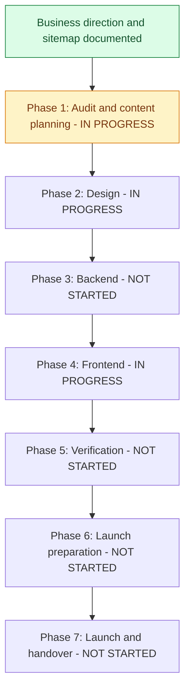

# RS Trade International: restructuring progress

Last updated: 2026-10-07 (Asia/Dhaka).

Source plan: [Website restructuring plan](restructuring-plan.md).

This file is the single place for progress and pending information. Separate review and content-checklist files are no longer used.

This is the ongoing tracker for the full website restructuring. Planning decisions are recorded separately from implementation: documenting a feature does not mean it has been built or verified.

## Current position

**Current phase:** Static corporate page implementation (Phase 4), with planning/design items still open.

**Completed:** Business direction, service list, order approach, full door-to-door responsibility, restructuring roadmap and planned sitemap have been documented.

**Next:** Review Projects and add real factory photos, short stories and public video links when supplied. Continue About Us and Contact as static pages. Backend work remains deferred.

**Implementation status:** Navigation, homepage draft, four services, static quotation form, initial Projects page and redesigned Ready Stock listing are implemented. Ready Stock uses clearly labelled sample products until real stock details are supplied. Projects uses empty static content lists until real material is supplied. Quote submissions remain disabled. Backend work is deferred; production database unchanged.

## Visual roadmap

If the Markdown viewer does not render Mermaid, use the phase table and checklists below. Phases can overlap when dependencies permit; the diagram shows the main sequence.

## Phase status

| Phase | Status | Completion requirement |
| --- | --- | --- |
| 1. Audit and content planning | In progress | Audit, sitemap/content inventory and scope review complete |
| 2. Design | In progress | Mobile/desktop layouts and visual direction agreed |
| 3. Backend | Not started | Product, content and inquiry flows implemented and verified |
| 4. Frontend | In progress | Planned pages and customer journeys implemented |
| 5. Verification | Not started | Relevant checks pass and material issues are resolved |
| 6. Launch preparation | Not started | Content, SEO, hosting, tracking and operations ready |
| 7. Launch and handover | Not started | Approved site published and management instructions delivered |

Status vocabulary: **Not started / In progress / Waiting for input / Complete**. Mark a task complete only when its stated outcome exists and any required verification has passed. Do not use speculative percentages.

## Phase 1 - Audit and content planning

- [x] Confirm corporate website plus small Ready Stock business model.
- [x] Confirm audience: wholesalers, importers, businesses and individual buyers.
- [x] Confirm English as the main website language.
- [x] Confirm four services and the Source -> Verify -> QC -> Ship -> Deliver journey.
- [x] Confirm initial 5-10 Ready Stock products and WhatsApp/phone order confirmation.
- [x] Confirm no online payment integration in the current scope.
- [x] Confirm complete door-to-door handling responsibilities.
- [x] Record the full restructuring roadmap in the source plan.
- [x] Document the full planned sitemap, page sections and proposed routes.
- [x] Create this progress tracker.
- [x] Audit existing pages, APIs, models, integrations and deployment configuration (source review; runtime checks pending).
- [x] Identify reusable features, demonstration content and migration requirements.
- [x] Review cart, checkout and account dependencies before changing navigation/routes.
- [x] Create a page-by-page content inventory with available/missing information.
- The useful findings and missing information are kept below; separate review documents were removed at the owner's request.
- [ ] Finalize static-export publishing/rebuild workflow or alternative Next runtime architecture.
- [ ] Review logo, brand colors and design preferences.
- [ ] Review the planned sitemap and finalize implementation scope/routes.

## Phase 2 - Design

- [ ] Define shared typography, colors, spacing and buttons.
- [x] Apply shared blue/yellow/neutral colors to the existing website; white navigation and yellow main inquiry actions.
- [ ] Review colors visually on mobile and desktop.
- [ ] Design desktop/mobile navigation and footer.
- [ ] Design desktop/mobile homepage and its planned sections.
- [ ] Design service overview and service detail template, including prominent QC.
- [ ] Design Ready Stock listing and product details.
- [ ] Design About Us, Our Work and project details.
- [ ] Design FAQ, Contact, quotation form and policy layouts.
- [ ] Review mobile contact actions, readability and accessibility.
- [ ] Review and agree the visual direction before full implementation.

## Phase 3 - Backend

- [ ] Plan safe schema migrations for existing product records.
- [ ] Add MOQ, request-price mode and delivery information.
- [ ] Review pricing/deal validation and product image support.
- [ ] Implement inquiry storage with service/product context and source page.
- [ ] Build inquiry storage/API in a future backend phase.
- [ ] Apply inquiry migration to the configured database after confirming its environment.
- [ ] Add product context when real Ready Stock inquiries are connected.
- [ ] Implement server-side validation, spam protection and submission limits.
- [ ] Add inquiry statuses and staff notes in a future backend phase.
- [ ] Configure inquiry email notifications and failure handling.
- [ ] Build email notifications and retry handling in a future backend phase.
- [ ] Verify real recipient/SMTP delivery after database setup.
- [ ] Implement required company/project content administration.
- [ ] Decide whether service copy and FAQs require editable admin records.
- [ ] Configure staff permissions and verify backend/API behavior.

## Phase 4 - Frontend

- [ ] Implement shared corporate layout, navigation and footer.
- [x] Implement responsive navigation, Services dropdown and Request a Quote link.
- [x] Redesign Sign In with the shared brand style, labelled fields, password visibility, loading/error feedback and existing account links.
- [x] Redesign Sign Up to match the simple Sign In card, with labelled fields, password visibility, verification guidance and compact social options.
- [ ] Review Sign Up on mobile/desktop and verify live account creation and email delivery separately.
- [ ] Review Sign In on mobile/desktop and verify live authentication separately.
- [ ] Review navigation in a browser on mobile and desktop.
- [ ] Replace the shop-focused homepage with the planned corporate sections.
- [x] Build the first homepage design with hero, process overview, four services, QC, door-to-door, Ready Stock link, FAQs and quotation links.
- [x] Move existing shopping homepage content to `/ready-stock` without deleting its components.
- [ ] Review homepage design on mobile and desktop; add genuine evidence and approved content when available.
- [ ] Implement About Us and services overview.
- [x] Implement initial China Product Sourcing page (introduction, support, process, checklist, related services, FAQ and inquiry links).
- [ ] Review sourcing page on mobile/desktop and connect it to the working quotation form when built.
- [x] Implement initial Supplier Verification page (checks, process, customer checklist, related services, FAQs and inquiry links).
- [ ] Review Supplier Verification on mobile/desktop and connect the quotation form when built.
- [x] Implement initial Quality Control & Inspection page with the six-step process, reporting details, customer checklist and FAQs.
- [x] Implement initial Shipping & Door-to-Door Import page with full handling, process, shipment checklist and FAQs.
- [ ] Review QC and shipping pages on mobile/desktop and connect the quotation form when built.
- [ ] Implement Ready Stock listing and individual product pages.
- [x] Redesign the initial static Ready Stock listing with search, sorting, product previews and an ordering guide; no public categories.
- [ ] Add approved Ready Stock products, price/MOQ/quantity details and separate product pages if needed; current details open in a preview dialog.
- [ ] Review Ready Stock on mobile and desktop with real product content.
- [ ] Implement product-aware WhatsApp links and phone actions.
- [ ] Implement Our Work and individual project pages.
- [x] Build the initial Projects page at `/our-work` with category filters, expandable photo stories and external video links.
- [ ] Add owner-supplied photos/stories and YouTube/Facebook URLs, then review populated cards on mobile/desktop.
- [ ] Build separate project detail pages later if needed; stories currently expand inside the listing.
- [ ] Implement FAQ and Contact pages.
- [x] Implement static quotation form with editable fields, service preselection and multiple-service selection; submission disabled.
- [ ] Connect and verify quotation submissions when the backend phase is authorized.
- [ ] Implement approved Privacy Policy and Terms pages.
- [ ] Integrate genuine approved content; withhold unavailable evidence sections.
- [x] Remove old category/product routes and unused shopping presentation components after dependency review; retain cart, buy-now and checkout for future use.
- [ ] Preserve useful URLs or implement redirects for replaced routes.

## Phase 5 - Verification

- [ ] Verify all planned pages, links and navigation.
- [ ] Verify mobile and desktop customer journeys without mandatory login.
- [ ] Verify product MOQ, stock, pricing mode and delivery information.
- [ ] Verify WhatsApp product context and confirmed phone numbers.
- [ ] Verify inquiry validation, persistence, feedback and notification delivery.
- [ ] Verify admin content management and permissions.
- [ ] Check accessibility and optimize media/page loading.
- [ ] Run appropriate frontend production build and backend checks.
- [ ] Resolve material defects and review final business claims/content.

## Phase 6 - Launch preparation

- [ ] Confirm production domain, hosting and business mailboxes.
- [ ] Finalize quotation inclusions, shipping details and applicable order terms.
- [ ] Add unique titles/descriptions, canonical URLs and internal links.
- [ ] Add sitemap, robots configuration and verified structured data.
- [ ] Verify replaced-URL redirects.
- [ ] Configure Analytics and verify successful inquiry/contact events.
- [ ] Verify Search Console ownership and submit sitemap.
- [ ] Review HTTPS, secrets, production settings and dependency maintenance.
- [ ] Configure database/media backups and verify restoration procedures.
- [ ] Complete launch checklist and prepare the concrete site for publication review.

## Phase 7 - Launch and handover

- [ ] Obtain publication approval for the completed site.
- [ ] Deploy and verify live pages, forms, contact links and admin access.
- [ ] Verify live email delivery and tracking configuration.
- [ ] Provide product, content and inquiry management instructions.
- [ ] Record maintenance, backup and support responsibilities.
- [ ] Record deployment details and outstanding follow-up work.

## Pending information and dependencies

### What we learned from the existing website

- We can reuse the product admin area and existing product storage.
- The original product pages used example data and are now removed. Cart, buy-now and checkout demo pages are retained for future development, outside the main navigation. Ready Stock has its own clearly labelled static previews.
- Some menu/footer links do not lead to built pages yet.
- We need a form that saves customer inquiries and notifies the team.
- We need to decide how adding a product in admin creates its public page. The current setup builds pages before publication.
- Existing product records and staff access should be preserved.
- Live email, hosting, backups and customer journeys still need checking.

These items await business content or account access; they do not prevent independent audit/design work.

| Item | Needed for | Status |
| --- | --- | --- |
| Logo/colors and visual preferences | Design | Awaiting review/input |
| Approved company/China-presence details | About, homepage | Awaiting content |
| Phone, WhatsApp, offices and hours | Contact actions | Awaiting confirmed details |
| Domain and active professional email | Email/launch | Awaiting confirmation/setup |
| Trade license details for publication | Credentials | Awaiting approved details |
| Initial products, photos, MOQ, prices and quantities | Ready Stock | Awaiting content |
| Real visits, inspections, projects and permitted feedback | Our Work/trust sections | Awaiting content |
| Shipping pricing inclusions, timelines, coverage and restrictions | Shipping details/terms | Awaiting details; full handling confirmed |
| Service and ready-stock terms | Policies/order information | Awaiting details |
| Hosting, Analytics and Search Console access | Launch preparation | Awaiting access when needed |

## Next work queue

Projects decisions: real factory photos are available from the owner but have not yet been added to the project. Show photos with stories, publish only details the owner chooses to share, use public YouTube/Facebook video links, and keep content static for now. `ui/content/projects.ts` stores stories and videos in their chosen display order; admin editing is future work. Empty states are displayed instead of invented project examples.

Current scope: static frontend only. The quotation page previews service choices and fields; details are not sent or saved. Inquiry API, models, migration, admin and email additions were removed. Existing account/backend features remain intact. No production migration was applied.

Ready Stock decisions: no category controls on the public page for now. Existing backend categories remain available for future use. Sample cards are clearly labelled as a catalog preview; product inquiries stay disabled until real products and business contact details are confirmed. Search, sorting and product-detail previews work locally without backend changes.

Cleanup decisions: old category/product routes and unused presentation components have been removed. Cart, add-to-cart, buy-now and checkout pages/components are retained for future use without main navigation links. Existing account pages, `profileModal.tsx`, Django backend and product/category records are preserved. The layout uses the shared `reduxInitializer.tsx`; its inline duplicate was removed. Old `/category_details` and `/product/*` URLs no longer exist; redirects for any previously published URLs must be reviewed before deployment. Removed 44 unused public pictures; the eight images referenced by Ready Stock and retained shopping pages remain. All referenced local picture files exist.

1. Review Projects and the four services; continue the remaining static corporate pages.
2. Collect company details, real contact information, products and photos using the pending-information table above.
3. Decide how new product pages will be published and how old links will work.

## Update rules

Update this file when a meaningful part of the restructuring is completed, such as navigation, homepage, a service page or inquiry handling. Small adjustments belong in that part's existing entry; do not add a new log entry for every height, color or spacing change.

1. Check its task box after verifying the outcome.
2. Update phase status, current position and the visual roadmap if a phase changes.
3. Update pending dependencies and the next work queue.
4. Add a dated activity entry with what changed and verification evidence or a file reference.
5. Update the last-updated date. If scope changes, update the source plan as well.

For incomplete work, leave the box unchecked and record the current state or dependency. Keep completed planning separate from completed code. Add newly discovered tasks to the relevant phase rather than silently omitting them.

## Completed milestones

Current palette: blue for links/highlights, yellow for main actions, white/light gray for page surfaces and charcoal for text/footer. Red and green are used for meaningful error/success states. Shades are inspired by the supplied logo screenshot; they are not exact samples from the original logo. Existing logo artwork has not been replaced.

Navigation follow-up (2026-10-05): restored Sign In beside the desktop quotation button and in the mobile menu. It links to the existing `/accounts/signin` page. TypeScript and navigation lint passed; authentication behavior was not changed.

| Date (Asia/Dhaka) | Meaningful part | Result and checks |
| --- | --- | --- |
| 2026-10-07 | Unused picture cleanup | Moved the 44 unused public pictures into unused-pictures.zip at the project root, recovering the previously deleted files from Git. The archive contains all 44 pictures and passes its integrity check; it can be moved elsewhere. Kept the eight images used by Ready Stock and restored cart/checkout in ui/public/images. No missing referenced pictures. Backend media and database unchanged. |
| 2026-10-07 | Old frontend cleanup and retained features | Removed 21 obsolete source files: category/product routes and components, banners, old hero/home/footer/contact blocks and old sidebar. At the owner's request, restored cart/add-to-cart, buy-now and checkout pages/components, profileModal.tsx and reduxInitializer.tsx. The layout now imports the shared initializer instead of defining a duplicate. Removed unused framer-motion and react-inner-image-zoom packages. Production build/type validation, static export and layout/account-component lint passed after restoration. Retained shopping pages remain demos outside the main navigation; profile modal is retained without changing navigation. Backend/database unchanged. Published-URL redirect review remains pending. |
| 2026-10-07 | Sign Up redesign | Matched the approved centered Sign In card: RS badge, blue accent, four labelled fields, password/confirmation visibility, yellow Create Account button, compact social icons and sign-in/website links. Existing creation endpoint, password checks, verification-email notification and redirect preserved. Form now submits through onSubmit, supports Enter and disables repeat submissions while loading. Removed unused keep-signed-in control and corrected metadata. TypeScript and changed-file ESLint passed. Browser review and live signup/email verification remain pending; no backend/database changes. |
| 2026-10-07 | Sign In redesign | Simplified to one centered white card with a blue accent, RS badge, email-first form, visible labels, password toggle and yellow sign-in button. Social options sit in a compact icon row with accessible names; signup, password recovery and return-to-website links remain. Existing login endpoint, token handling and verification preserved. Removed the unused keep-signed-in checkbox and corrected metadata. Initial production export passed; TypeScript and changed-file ESLint passed again after simplification. Browser and live authentication checks remain pending; no backend/database changes. |
| 2026-10-07 | Ready Stock redesign | Replaced the old shopping layout at `/ready-stock` with a responsive product grid, search, alphabetical sorting, product-detail dialogs, ordering guide and shared company footer. Public categories removed from this page; backend categories unchanged. Six sample items are explicitly marked as previews; price, MOQ, quantity and contact actions await real details. TypeScript, changed-file ESLint and production export passed. Browser review and real product/contact content remain pending. |
| 2026-10-04 | Website plan and progress tracking | Business model, services, full door-to-door handling, sitemap and task list recorded. Progress is maintained here. |
| 2026-10-04 | Existing website review | Identified reusable admin/product storage, example shopping features and missing pages/inquiry handling. Useful findings and pending information are kept in this file. Live checks remain pending. |
| 2026-10-04 | Navigation implementation | Main order: Home, Services, Ready Stock, Projects, About Us, Contact; Request a Quote stays on the right. Dropdown contains only the four services; the overview link was removed at the owner's request. Desktop/mobile share this order. Added mobile menu and active-page styles; removed shopping controls. Desktop height is 90px; mobile is 64px, with matching page spacing. Initial production build passed; TypeScript and component lint passed for the arrangement update. Full browser review and destination pages remain pending. |
| 2026-10-04 | Shopping content moved and first corporate homepage built | Previous home content preserved at `ui/app/ready-stock/page.tsx`. New `ui/app/page.tsx` presents services, process, QC, import support, FAQ and inquiry links. TypeScript, changed-page ESLint and production export passed, including `/ready-stock`. Browser review, real product data, evidence, service pages and quotation handling remain pending. |
| 2026-10-04 | Shared website colors | Added centralized blue, yellow and neutral shades; white header, light QC/contact sections, charcoal footer, yellow primary inquiry/account actions. Replaced orange shopping accents and account gradients. TypeScript, homepage/navigation/theme lint and production export passed. A final input-background correction was made after the build; visual review remains pending. |
| 2026-10-04 | Initial China Product Sourcing page | Built `/services/china-product-sourcing` with the agreed sections, shared company footer, page title/description and service-specific quotation links. TypeScript, page/footer lint and production export passed. Quotation form and related service destinations are still pending; no negotiation/sample promises or fabricated evidence added. |
| 2026-10-04 | Initial Supplier Verification page | Built `/services/supplier-verification` with supplier identity/business/capability information, four-step process, customer checklist, related services, FAQs and service-specific quotation links. Shared palette/footer and page title/description included. TypeScript, page lint and production export passed. Browser review, quotation handling and final operational content remain pending. |
| 2026-10-04 | Initial QC and Door-to-Door Import pages | Built `/services/quality-control` and `/services/door-to-door-import` with shared service layout, six-step processes, checklists, FAQs, related services, metadata and quotation links. All four service destinations now exist. TypeScript, changed-file lint and production export passed. Browser review, quotation handling, real evidence and final business terms remain pending. |
| 2026-10-05 | Static quotation page | Built `/request-a-quote` with service preselection, multiple selections and editable fields. Submission is disabled with a clear notice. Backend additions were removed after the owner deferred backend work; no production database changes. TypeScript and changed-file lint passed for the static version. |
| 2026-10-05 | Initial static Projects page | Built `/our-work` with shared colors/footer, three project categories, filters, expandable photo stories and YouTube/Facebook link support. No fictional entries: real content is pending in `ui/content/projects.ts`. TypeScript, changed-file lint and production export passed. Populated gallery/browser review and actual media remain pending; no backend added. |

