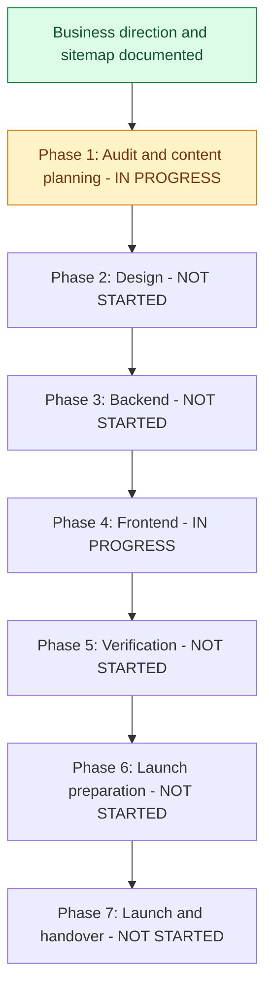

# RS Trade International: restructuring progress

Last updated: 2026-10-04 (Asia/Dhaka).

Source plan: [Website restructuring plan](restructuring-plan.md).

Phase 1 outputs: [Source audit](restructure-audit.md) and [content inventory](restructure-content-inventory.md).

This is the ongoing tracker for the full website restructuring. Planning decisions are recorded separately from implementation: documenting a feature does not mean it has been built or verified.

## Current position

**Current phase:** Navigation implementation (Phase 4), with planning/design items still open.

**Completed:** Business direction, service list, order approach, full door-to-door responsibility, restructuring roadmap and planned sitemap have been documented.

**Next:** Review navigation on mobile and desktop, then design the homepage. Build the planned destination pages in the frontend phase.

**Implementation status:** Navigation is implemented. Its planned destination pages still need building. Runtime integrations and deployment remain unverified.

## Visual roadmap

If the Markdown viewer does not render Mermaid, use the phase table and checklists below. Phases can overlap when dependencies permit; the diagram shows the main sequence.

## Phase status

| Phase | Status | Completion requirement |
| --- | --- | --- |
| 1. Audit and content planning | In progress | Audit, sitemap/content inventory and scope review complete |
| 2. Design | Not started | Mobile/desktop layouts and visual direction agreed |
| 3. Backend | Not started | Product, content and inquiry flows implemented and verified |
| 4. Frontend | In progress | Planned pages and customer journeys implemented |
| 5. Verification | Not started | Relevant checks pass and material issues are resolved |
| 6. Launch preparation | Not started | Content, SEO, hosting, tracking and operations ready |
| 7. Launch and handover | Not started | Approved site published and management instructions delivered |

Status vocabulary: **Not started / In progress / Waiting for input / Complete**. Mark a task complete only when its stated outcome exists and any required verification has passed. Do not use speculative percentages.

## Phase 1 - Audit and content planning

- [x] Confirm corporate website plus small Ready Stock business model.
- [x] Confirm audience: wholesalers, importers, businesses and individual buyers.
- [x] Confirm English as the main website language.
- [x] Confirm four services and the Source -> Verify -> QC -> Ship -> Deliver journey.
- [x] Confirm initial 5-10 Ready Stock products and WhatsApp/phone order confirmation.
- [x] Confirm no online payment integration in the current scope.
- [x] Confirm complete door-to-door handling responsibilities.
- [x] Record the full restructuring roadmap in the source plan.
- [x] Document the full planned sitemap, page sections and proposed routes.
- [x] Create this progress tracker.
- [x] Audit existing pages, APIs, models, integrations and deployment configuration (source review; runtime checks pending).
- [x] Identify reusable features, demonstration content and migration requirements.
- [x] Review cart, checkout and account dependencies before changing navigation/routes.
- [x] Create a page-by-page content inventory with available/missing information.
- [ ] Finalize static-export publishing/rebuild workflow or alternative Next runtime architecture.
- [ ] Review logo, brand colors and design preferences.
- [ ] Review the planned sitemap and finalize implementation scope/routes.

## Phase 2 - Design

- [ ] Define shared typography, colors, spacing and buttons.
- [ ] Design desktop/mobile navigation and footer.
- [ ] Design desktop/mobile homepage and its planned sections.
- [ ] Design service overview and service detail template, including prominent QC.
- [ ] Design Ready Stock listing and product details.
- [ ] Design About Us, Our Work and project details.
- [ ] Design FAQ, Contact, quotation form and policy layouts.
- [ ] Review mobile contact actions, readability and accessibility.
- [ ] Review and agree the visual direction before full implementation.

## Phase 3 - Backend

- [ ] Plan safe schema migrations for existing product records.
- [ ] Add MOQ, request-price mode and delivery information.
- [ ] Review pricing/deal validation and product image support.
- [ ] Implement inquiry storage with service/product context and source page.
- [ ] Implement server-side validation, spam protection and submission limits.
- [ ] Add inquiry statuses and internal notes in admin.
- [ ] Configure inquiry email notifications and failure handling.
- [ ] Implement required company/project content administration.
- [ ] Decide whether service copy and FAQs require editable admin records.
- [ ] Configure staff permissions and verify backend/API behavior.

## Phase 4 - Frontend

- [ ] Implement shared corporate layout, navigation and footer.
- [x] Implement responsive navigation, Services dropdown and Request a Quote link.
- [ ] Review navigation in a browser on mobile and desktop.
- [ ] Replace the shop-focused homepage with the planned corporate sections.
- [ ] Implement About Us and services overview.
- [ ] Implement China Product Sourcing page.
- [ ] Implement Supplier Verification page.
- [ ] Implement Quality Control & Inspection page.
- [ ] Implement Shipping & Door-to-Door Import page.
- [ ] Implement Ready Stock listing and individual product pages.
- [ ] Implement product-aware WhatsApp links and phone actions.
- [ ] Implement Our Work and individual project pages.
- [ ] Implement FAQ and Contact pages.
- [ ] Implement contextual quotation form, validation and submission feedback.
- [ ] Implement approved Privacy Policy and Terms pages.
- [ ] Integrate genuine approved content; withhold unavailable evidence sections.
- [ ] Remove cart/checkout from the primary journey after dependency review.
- [ ] Preserve useful URLs or implement redirects for replaced routes.

## Phase 5 - Verification

- [ ] Verify all planned pages, links and navigation.
- [ ] Verify mobile and desktop customer journeys without mandatory login.
- [ ] Verify product MOQ, stock, pricing mode and delivery information.
- [ ] Verify WhatsApp product context and confirmed phone numbers.
- [ ] Verify inquiry validation, persistence, feedback and notification delivery.
- [ ] Verify admin content management and permissions.
- [ ] Check accessibility and optimize media/page loading.
- [ ] Run appropriate frontend production build and backend checks.
- [ ] Resolve material defects and review final business claims/content.

## Phase 6 - Launch preparation

- [ ] Confirm production domain, hosting and business mailboxes.
- [ ] Finalize quotation inclusions, shipping details and applicable order terms.
- [ ] Add unique titles/descriptions, canonical URLs and internal links.
- [ ] Add sitemap, robots configuration and verified structured data.
- [ ] Verify replaced-URL redirects.
- [ ] Configure Analytics and verify successful inquiry/contact events.
- [ ] Verify Search Console ownership and submit sitemap.
- [ ] Review HTTPS, secrets, production settings and dependency maintenance.
- [ ] Configure database/media backups and verify restoration procedures.
- [ ] Complete launch checklist and prepare the concrete site for publication review.

## Phase 7 - Launch and handover

- [ ] Obtain publication approval for the completed site.
- [ ] Deploy and verify live pages, forms, contact links and admin access.
- [ ] Verify live email delivery and tracking configuration.
- [ ] Provide product, content and inquiry management instructions.
- [ ] Record maintenance, backup and support responsibilities.
- [ ] Record deployment details and outstanding follow-up work.

## Pending information and dependencies

These items await business content or account access; they do not prevent independent audit/design work.

| Item | Needed for | Status |
| --- | --- | --- |
| Logo/colors and visual preferences | Design | Awaiting review/input |
| Approved company/China-presence details | About, homepage | Awaiting content |
| Phone, WhatsApp, offices and hours | Contact actions | Awaiting confirmed details |
| Domain and active professional email | Email/launch | Awaiting confirmation/setup |
| Trade license details for publication | Credentials | Awaiting approved details |
| Initial products, photos, MOQ, prices and quantities | Ready Stock | Awaiting content |
| Real visits, inspections, projects and permitted feedback | Our Work/trust sections | Awaiting content |
| Shipping pricing inclusions, timelines, coverage and restrictions | Shipping details/terms | Awaiting details; full handling confirmed |
| Service and ready-stock terms | Policies/order information | Awaiting details |
| Hosting, Analytics and Search Console access | Launch preparation | Awaiting access when needed |

## Next work queue

1. Review implemented navigation on mobile and desktop; confirm logo/colors and design the homepage.
2. Collect approved contact/company/product information using the content inventory.
3. Finalize publishing architecture and route transitions before implementation.

## Update rules

Whenever a restructuring task is completed:

1. Check its task box after verifying the outcome.
2. Update phase status, current position and the visual roadmap if a phase changes.
3. Update pending dependencies and the next work queue.
4. Add a dated activity entry with what changed and verification evidence or a file reference.
5. Update the last-updated date. If scope changes, update the source plan as well.

For incomplete work, leave the box unchecked and record the current state or dependency. Keep completed planning separate from completed code. Add newly discovered tasks to the relevant phase rather than silently omitting them.

## Activity log

Latest navigation height: desktop is 90px with matching page padding. Mobile remains 64px. This replaces the previous 100px setting.

Latest navigation height: desktop is 100px with matching page padding, as requested. Mobile remains 64px. This supersedes the earlier desktop height choices.

Navigation height update: set the desktop header to 120px at the owner's request and matched desktop page padding. Mobile remains 64px. This replaces the earlier 80px desktop setting.

Navigation height follow-up: increased desktop header height to 80px, kept mobile at 64px and matched the shared page padding to each height. Browser review remains pending.

Navigation spacing follow-up: removed the homepage's old header margin and use shared top padding for the fixed navigation. The homepage background now begins directly beneath the header. Browser confirmation remains pending.

The website review and content checklist now use simple English. Their filenames stay the same so existing links continue to work.

| Date (Asia/Dhaka) | Work completed | Evidence / verification |
| --- | --- | --- |
| 2026-10-04 | Consolidated business direction, full roadmap and planned sitemap; recorded full door-to-door responsibility | Owner discussion and [source plan](restructuring-plan.md); exact dates of earlier discussions are not asserted |
| 2026-10-04 | Created visual progress tracker, phase checklists and next-work queue | This document; website implementation remains pending |
| 2026-10-04 | Completed source audit, reuse/migration review and page content inventory; repaired source-plan links after filename change | [Audit](restructure-audit.md), [inventory](restructure-content-inventory.md); no runtime checks or application changes |
| 2026-10-04 | Rewrote the two review documents in simple English, with examples and owner checklists | [Current website review](restructure-audit.md) and [Information needed](restructure-content-inventory.md); website code unchanged |
| 2026-10-04 | Rebuilt navigation with planned links, Services dropdown, quote action, mobile toggle, active states and keyboard dismissal; removed shopping controls from header | `ui/components/navBar/navbar.tsx`; TypeScript, component ESLint and production build passed. Destination pages and browser review remain pending. |
