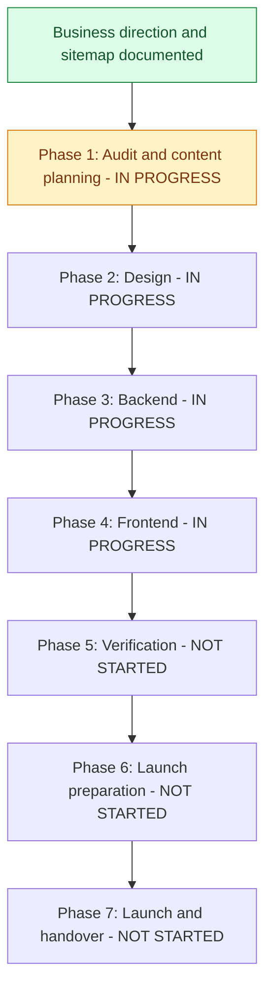

# RS Trade International: restructuring progress

Last updated: 2026-10-15 (Asia/Dhaka).

Source plan: [Website restructuring plan](restructuring-plan.md).

This file is the single place for progress and pending information. Separate review and content-checklist files are no longer used.

This is the ongoing tracker for the full website restructuring. Planning decisions are recorded separately from implementation: documenting a feature does not mean it has been built or verified.

## Current position

**Current phase:** Static corporate page implementation (Phase 4), with planning/design items still open.

**Completed:** Business direction, service list, order approach, full door-to-door responsibility, restructuring roadmap and planned sitemap have been documented.

**Next:** Review the database-backed Ready Stock and product pages with real active products. Account cart syncing is implemented in code; apply the pending catalog migration when ready, then manually review sign-in merging, saving, sign-out and cross-device loading. Continue collecting Projects, About Us and Contact content. Inquiry submission and payments remain deferred.

**Implementation status:** Corporate pages and admin redesign remain in place. Ready Stock and product details now load published products, prices, stock and Cloudinary images from the Django database through a public catalog API. Search, sorting, 12-product pagination, loading/error states and missing-image placeholders are implemented. Cart, Buy Now and order-review totals use the same database IDs and current prices. Product availability is checked when cart/review pages open; unavailable items or quantities above stock block review until corrected. Guest carts remain browser-saved. Signed-in cart syncing is implemented with queued, idempotent backend updates and account isolation, but activation awaits catalog migration 0003_account_cart; that production migration has not been applied. Addresses remain browser-saved per account. No payment or order submission is enabled; quotations remain static. Live browser review is pending.

## Visual roadmap

If the Markdown viewer does not render Mermaid, use the phase table and checklists below. Phases can overlap when dependencies permit; the diagram shows the main sequence.

## Phase status

| Phase | Status | Completion requirement |
| --- | --- | --- |
| 1. Audit and content planning | In progress | Audit, sitemap/content inventory and scope review complete |
| 2. Design | In progress | Mobile/desktop layouts and visual direction agreed |
| 3. Backend | In progress | Product, content and inquiry flows implemented and verified |
| 4. Frontend | In progress | Planned pages and customer journeys implemented |
| 5. Verification | Not started | Relevant checks pass and material issues are resolved |
| 6. Launch preparation | Not started | Content, SEO, hosting, tracking and operations ready |
| 7. Launch and handover | Not started | Approved site published and management instructions delivered |

Status vocabulary: **Not started / In progress / Waiting for input / Complete**. Mark a task complete only when its stated outcome exists and any required verification has passed. Do not use speculative percentages.

## Phase 1 - Audit and content planning

- [x] Confirm corporate website plus small Ready Stock business model.
- [x] Confirm audience: wholesalers, importers, businesses and individual buyers.
- [x] Confirm English as the main website language.
- [x] Confirm four services and the Source -> Verify -> QC -> Ship -> Deliver journey.
- [x] Confirm initial 5-10 Ready Stock products and WhatsApp/phone order confirmation.
- [x] Confirm no online payment integration in the current scope.
- [x] Confirm complete door-to-door handling responsibilities.
- [x] Record the full restructuring roadmap in the source plan.
- [x] Document the full planned sitemap, page sections and proposed routes.
- [x] Create this progress tracker.
- [x] Audit existing pages, APIs, models, integrations and deployment configuration (source review; runtime checks pending).
- [x] Identify reusable features, demonstration content and migration requirements.
- [x] Review cart, checkout and account dependencies before changing navigation/routes.
- [x] Create a page-by-page content inventory with available/missing information.
- The useful findings and missing information are kept below; separate review documents were removed at the owner's request.
- [ ] Finalize static-export publishing/rebuild workflow or alternative Next runtime architecture.
- [ ] Review logo, brand colors and design preferences.
- [ ] Review the planned sitemap and finalize implementation scope/routes.

## Phase 2 - Design

- [ ] Define shared typography, colors, spacing and buttons.
- [x] Apply shared blue/yellow/neutral colors to the existing website; white navigation and yellow main inquiry actions.
- [ ] Review colors visually on mobile and desktop.
- [ ] Design desktop/mobile navigation and footer.
- [ ] Design desktop/mobile homepage and its planned sections.
- [ ] Design service overview and service detail template, including prominent QC.
- [ ] Design Ready Stock listing and product details.
- [ ] Design About Us, Our Work and project details.
- [ ] Design FAQ, Contact, quotation form and policy layouts.
- [ ] Review mobile contact actions, readability and accessibility.
- [ ] Review and agree the visual direction before full implementation.

## Phase 3 - Backend

- [ ] Plan safe schema migrations for existing product records.
- [ ] Add MOQ, request-price mode and delivery information.
- [ ] Review pricing/deal validation and product image support.
- [ ] Implement inquiry storage with service/product context and source page.
- [ ] Build inquiry storage/API in a future backend phase.
- [ ] Apply inquiry migration to the configured database after confirming its environment.
- [ ] Add product context when real Ready Stock inquiries are connected.
- [ ] Implement server-side validation, spam protection and submission limits.
- [ ] Add inquiry statuses and staff notes in a future backend phase.
- [ ] Configure inquiry email notifications and failure handling.
- [ ] Build email notifications and retry handling in a future backend phase.
- [ ] Verify real recipient/SMTP delivery after database setup.
- [ ] Implement required company/project content administration.
- [ ] Decide whether service copy and FAQs require editable admin records.
- [ ] Configure staff permissions and verify backend/API behavior.

## Phase 4 - Frontend

- [x] Modernize the Django admin dashboard and shared admin theme with the website's blue/yellow/white palette, All available management options appear directly as compact cards grouped under Catalog and Accounts, with direct Manage/View and Add actions. Kept the simple heading, comfortable side spacing, yellow View website button and one Recent Activity section on the right. Browser review remains pending.
  Compatibility fix: upgraded the local environment and requirements pin from Django 5.1.4 to 5.2.17 for Python 3.14. The old version reproduced the template-context copy error in Users and Categories. Both complete list-page requests now return 200 in isolated tests. All 13 admin/profile checks and pip dependency validation pass. Refreshed collected admin assets using isolated settings. Restart the running Django server to load the new package; live browser recheck remains pending. Production database and migrations were untouched; database tests used a disposable in-memory SQLite database.
  Follow-up: the owner's screenshot showed new HTML with the older CSS. The localhost CSS response matches the updated source. Added a versioned stylesheet URL to refresh browser caches and explicit 25px icon dimensions to prevent oversized icons if CSS is unavailable. Isolated admin checks passed; visual recheck remains pending.
- [ ] Implement shared corporate layout, navigation and footer.
- [x] Implement responsive navigation, Services dropdown and Request a Quote link.
- [x] Redesign Sign In with the shared brand style, labelled fields, password visibility, loading/error feedback and existing account links.
- [x] Redesign Sign Up to match the simple Sign In card, with labelled fields, password visibility, verification guidance and compact social options.
- [ ] Review Sign Up on mobile/desktop and verify live account creation and email delivery separately.
- [ ] Review Sign In on mobile/desktop and verify live authentication separately.
- [ ] Review navigation in a browser on mobile and desktop.
- [ ] Replace the shop-focused homepage with the planned corporate sections.
- [x] Build the first homepage design with hero, process overview, four services, QC, door-to-door, Ready Stock link, FAQs and quotation links.
- [x] Move existing shopping homepage content to `/ready-stock` without deleting its components.
- [ ] Review homepage design on mobile and desktop; add genuine evidence and approved content when available.
- [ ] Implement About Us and services overview.
- [x] Implement initial China Product Sourcing page (introduction, support, process, checklist, related services, FAQ and inquiry links).
- [ ] Review sourcing page on mobile/desktop and connect it to the working quotation form when built.
- [x] Implement initial Supplier Verification page (checks, process, customer checklist, related services, FAQs and inquiry links).
- [ ] Review Supplier Verification on mobile/desktop and connect the quotation form when built.
- [x] Implement initial Quality Control & Inspection page with the six-step process, reporting details, customer checklist and FAQs.
- [x] Implement initial Shipping & Door-to-Door Import page with full handling, process, shipment checklist and FAQs.
- [ ] Review QC and shipping pages on mobile/desktop and connect the quotation form when built.
- [x] Implement initial static Ready Stock listing and individual product pages.
- [x] Redesign the initial static Ready Stock listing with search, sorting, product previews and an ordering guide; no public categories.
- [x] Replace product preview dialogs with six dedicated `/product/[id]` pages and an accessible enlarged-image dialog with zoom controls.
- [x] Add clearly labelled demo BDT prices, quantity-based subtotals and full-screen image zoom with hover, drag, wheel and pinch controls. Real prices and browser gesture review remain pending.
- [x] Add multiple saved profile addresses with edit/remove/default controls, delivery selection in Buy Now/checkout and a return path through Profile or Sign In. Browser storage only; server synchronization remains future work.
- [x] Connect quantity selection, browser-persisted cart, cart badge, independent Buy Now selection and order-request review.
  The cart badge counts different products, not total units: one product with quantity five shows 1. Cart and order-review quantities still show the requested units.
- [ ] Add approved Ready Stock products, price/MOQ/quantity details and business contact actions.
- [ ] Review Ready Stock on mobile and desktop with real product content.
- [ ] Implement product-aware WhatsApp links and phone actions.
- [ ] Implement Our Work and individual project pages.
- [x] Build the initial Projects page at `/our-work` with category filters, expandable photo stories and external video links.
- [ ] Add owner-supplied photos/stories and YouTube/Facebook URLs, then review populated cards on mobile/desktop.
- [ ] Build separate project detail pages later if needed; stories currently expand inside the listing.
- [ ] Implement FAQ and Contact pages.
- [x] Implement static quotation form with editable fields, service preselection and multiple-service selection; submission disabled.
- [ ] Connect and verify quotation submissions when the backend phase is authorized.
- [ ] Implement approved Privacy Policy and Terms pages.
- [ ] Integrate genuine approved content; withhold unavailable evidence sections.
- [x] Remove old category/product routes and unused shopping presentation components after dependency review; retain cart, buy-now and checkout for future use.
- [ ] Preserve useful URLs or implement redirects for replaced routes.

## Phase 5 - Verification

- [ ] Verify all planned pages, links and navigation.
- [ ] Verify mobile and desktop customer journeys without mandatory login.
- [ ] Verify product MOQ, stock, pricing mode and delivery information.
- [ ] Verify WhatsApp product context and confirmed phone numbers.
- [ ] Verify inquiry validation, persistence, feedback and notification delivery.
- [ ] Verify admin content management and permissions.
- [ ] Check accessibility and optimize media/page loading.
- [ ] Run appropriate frontend production build and backend checks.
- [ ] Resolve material defects and review final business claims/content.

## Phase 6 - Launch preparation

- [ ] Confirm production domain, hosting and business mailboxes.
- [ ] Finalize quotation inclusions, shipping details and applicable order terms.
- [ ] Add unique titles/descriptions, canonical URLs and internal links.
- [ ] Add sitemap, robots configuration and verified structured data.
- [ ] Verify replaced-URL redirects.
- [ ] Configure Analytics and verify successful inquiry/contact events.
- [ ] Verify Search Console ownership and submit sitemap.
- [ ] Review HTTPS, secrets, production settings and dependency maintenance.
- [ ] Configure database/media backups and verify restoration procedures.
- [ ] Complete launch checklist and prepare the concrete site for publication review.

## Phase 7 - Launch and handover

- [ ] Obtain publication approval for the completed site.
- [ ] Deploy and verify live pages, forms, contact links and admin access.
- [ ] Verify live email delivery and tracking configuration.
- [ ] Provide product, content and inquiry management instructions.
- [ ] Record maintenance, backup and support responsibilities.
- [ ] Record deployment details and outstanding follow-up work.

## Pending information and dependencies

### What we learned from the existing website

- We can reuse the product admin area and existing product storage.
- Original product and checkout demo content has been replaced. Dedicated product pages, cart, Buy Now and checkout now share the current Ready Stock catalog and quantities. Products now load from admin records; real catalog content and direct contact actions still need owner review.
- Some menu/footer links do not lead to built pages yet.
- We need a form that saves customer inquiries and notifies the team.
- We need to decide how adding a product in admin creates its public page. The current setup builds pages before publication.
- Existing product records and staff access should be preserved.
- Live email, hosting, backups and customer journeys still need checking.

These items await business content or account access; they do not prevent independent audit/design work.

| Item | Needed for | Status |
| --- | --- | --- |
| Logo/colors and visual preferences | Design | Awaiting review/input |
| Approved company/China-presence details | About, homepage | Awaiting content |
| Phone, WhatsApp, offices and hours | Contact actions | Awaiting confirmed details |
| Domain and active professional email | Email/launch | Awaiting confirmation/setup |
| Trade license details for publication | Credentials | Awaiting approved details |
| Initial products, photos, MOQ, prices and quantities | Ready Stock | Awaiting content |
| Real visits, inspections, projects and permitted feedback | Our Work/trust sections | Awaiting content |
| Shipping pricing inclusions, timelines, coverage and restrictions | Shipping details/terms | Awaiting details; full handling confirmed |
| Service and ready-stock terms | Policies/order information | Awaiting details |
| Hosting, Analytics and Search Console access | Launch preparation | Awaiting access when needed |

## Next work queue

Product publishing: in Admin, add or edit a product, choose its category, upload an image, enter the BDT price and available stock, then set Status to Active and save. Its category and optional subcategory must also be active. Draft/Archived products stay private. Refresh Ready Stock to see saved changes. Updating products does not require another frontend build. Production migrations remain pending where previously requested; this catalog connection needs none.

Future admin features: register each new model with Django admin using `admin.site.register(...)` or `@admin.register(...)`. The main dashboard will automatically show its card, and its list will inherit the shared design and 25-row paging. Set that model's `list_display`, `search_fields`, `list_filter` and form fields for its business needs. No separate list template or stylesheet is needed. Standard add/edit forms also inherit the shared change-form template and stylesheet, including built-in user-add forms. Standalone custom views should extend the shared admin base template.

Projects decisions: real factory photos are available from the owner but have not yet been added to the project. Show photos with stories, publish only details the owner chooses to share, use public YouTube/Facebook video links, and keep content static for now. `ui/content/projects.ts` stores stories and videos in their chosen display order; admin editing is future work. Empty states are displayed instead of invented project examples.

Current scope: database-backed public product catalog plus the existing frontend. Account cart syncing is implemented in code and awaits the pending catalog migration before it can save to the configured database. The quotation page previews service choices and fields; details are not sent or saved. Inquiry API, models, migration, admin and email additions were removed. Existing account/backend features remain intact. No production migration was applied.

Ready Stock decisions: public categories remain hidden. Products come from admin records rather than hardcoded examples. Only Active products in active categories/subcategories are public; zero-stock items stay visible with ordering disabled. Any test records already stored in admin also appear if Active; no existing database records were changed. The listing supports search, featured/name/price ordering and 12-item pages. Product details use `/product/?id=<database ID>` so newly added products work with the existing static-export hosting without a rebuild. Product-specific server-rendered metadata and legacy URL redirect review remain future SEO work. Cart version 2 stores database IDs, intentionally leaving old demo selections separate. Cart and Buy Now fetch current product details in batches and block review for unavailable items or excessive quantities. Account cart persistence is implemented in code using authenticated /api/cart/ requests. Guest selections merge on sign-in, retries cannot add twice, and sign-out clears active account selections. Activation awaits catalog migration 0003_account_cart. Buy Now stays a separate browser selection per account. Addresses remain saved separately per signed-in account on this browser and do not sync across devices. Checkout still prepares a copyable inquiry rather than placing an order. Official WhatsApp/phone actions, MOQ and delivery details still need confirmed information.

Cleanup decisions: old category/product demo content and unused presentation components were removed. The old six demo product routes have been replaced by the database-backed `/product/?id=...` page, with cart/add-to-cart, buy-now and checkout connected to database selections. The navbar has a cart icon. Existing account pages, `profileModal.tsx`, Django backend and product/category records are preserved. The layout uses the shared `reduxInitializer.tsx`. Old `/category_details` and former `/product/product1` style URLs remain removed; review redirects for published URLs before deployment. Unused picture files are preserved in unused-pictures.zip; current public product pictures remain.

1. Review Projects and the four services; continue the remaining static corporate pages.
2. Collect company details, real contact information, products and photos using the pending-information table above.
3. Apply the account-cart migration when ready and manually review the flow, then review old product URL redirects and product-specific SEO.

## Update rules

Update this file when a meaningful part of the restructuring is completed, such as navigation, homepage, a service page or inquiry handling. Small adjustments belong in that part's existing entry; do not add a new log entry for every height, color or spacing change.

1. Check its task box after verifying the outcome.
2. Update phase status, current position and the visual roadmap if a phase changes.
3. Update pending dependencies and the next work queue.
4. Add a dated activity entry with what changed and verification evidence or a file reference.
5. Update the last-updated date. If scope changes, update the source plan as well.

For incomplete work, leave the box unchecked and record the current state or dependency. Keep completed planning separate from completed code. Add newly discovered tasks to the relevant phase rather than silently omitting them.

## Completed milestones

Current palette: blue for links/highlights, yellow for main actions, white/light gray for page surfaces and charcoal for text/footer. Red and green are used for meaningful error/success states. Shades are inspired by the supplied logo screenshot; they are not exact samples from the original logo. Existing logo artwork has not been replaced.

Navigation follow-up (2026-10-05): restored Sign In beside the desktop quotation button and in the mobile menu. It links to the existing `/accounts/signin` page. TypeScript and navigation lint passed; authentication behavior was not changed.

Account navigation follow-up (2026-10-07): the navbar now uses ProfileModal on desktop and mobile. Signed-in visitors see their name with My Profile and Sign Out; guests see Sign In. Updated the restored menu to the shared palette, added outside-click/Escape dismissal and a fallback when the user's name is missing. TypeScript, changed-component ESLint and simulated guest/signed-in rendering checks passed. Live social sign-in still needs a browser check; no OAuth or backend changes.

| Date (Asia/Dhaka) | Meaningful part | Result and checks |
| --- | --- | --- |
| 2026-10-15 | Account cart implementation - migration pending | Added AccountCart and idempotency receipts with authenticated GET/POST /api/cart/. Server validates product availability, stock, quantities and the 100-product limit, serializes mutations per account and ignores repeated operation IDs. Frontend keeps guest carts, transfers their selections on sign-in, queues account updates with browser recovery, refreshes saved selections when cart pages open/window regains focus, and clears private cart state immediately on logout/account changes. Added loading/saving/saved/error/retry feedback; order review waits for successful sync. Buy Now remains separate and browser-local per account. Guarded token refresh against overwriting another session. Only TypeScript, changed-source lint/Python syntax and one isolated in-memory account-isolation/idempotency/stock/migration check were run; no test files added. Migration catalog/0003_account_cart.py was created but NOT applied to the configured production database. Account syncing will remain unavailable there until the owner applies it. Frontend export was not rebuilt; use the dev server or rebuild for Django-served UI. Manual UI/device review remains pending. |
| 2026-10-15 | Catalog category cleanup | At the owner's request, retained only Electronics, Fashion and Home Appliances, with their existing products and subcategories. Removed Automotive, Beauty & Personal Care, Books & Stationery, and Sports & Outdoors: 91 products, 20 subcategories and 3 related deal-product links. Cleanup was backed up first and committed in one transaction; no cross-linked retained products were found. Remaining catalog: 3 categories, 34 products and 15 subcategories. Backup fixture: backups/catalog-before-category-cleanup-2026-10-15-4d65ee00.json (118 removed records). Backup folder is ignored by Git. Cloudinary assets were not deleted; existing deals were retained. Refresh admin and Ready Stock to review. |
| 2026-10-15 | Ready Stock loading performance | Measured the running public API: 12 products returned in about 4KB, with requests taking 10.94-16.03 seconds. Added Server-Timing headers and identified 11.49 seconds in PostgreSQL connection setup. Installed/pinned psycopg-pool 3.3.3 and enabled a bounded pool of 1-4 connections with health checks and the required CONN_MAX_AGE=0. Later measured pool checkout at 0.44 seconds and a full API response at 3.78 seconds; remote database/query latency remains variable. Removed the unconditional 250ms frontend delay from initial loading, sorting, page changes and retries; only typed search is debounced. Increased catalog request timeout to allow a cold database connection. Only essential Python syntax and TypeScript checks plus live read-only API timings were used; no test files or database migrations/data changes. Review Ready Stock manually. |
| 2026-10-15 | Test-file cleanup | At the owner's request, removed the added admin tests, isolated admin test settings, catalog tests, profile tests and frontend cart tests. Removed the cart test npm script and test-directory formatting references. Earlier test results remain in this history as records of checks performed before removal. Future work will prioritize implementation with only essential checks; the owner will review the UI and interactions manually. |
| 2026-10-15 | Database-backed Ready Stock and products | Replaced the six hardcoded demo products with public Django list/detail/batch APIs and runtime frontend loading. Only Active products in active classifications are public; no categories appear publicly. Listing has database search, featured/name/price ordering and 12-item pagination. Product details load via a generic exported /product/?id= route, retain zoom, show current BDT price/stock and use optimized HTTPS Cloudinary URLs with a neutral missing-image placeholder. Cart/Buy Now/review now use database IDs, current prices and stock checks; deleted/hidden items stay removable and block review. Browser cart key moved to v2 so demo IDs cannot become real products. Account syncing remains next. All 30 isolated backend tests, 17 cart/address/catalog tests, changed-source ESLint, TypeScript validation and production static export passed. API list uses two database queries per page in tests. Existing production records were neither read nor changed; no migration required. Live browser/API integration and real catalog content review remain pending. |
| 2026-10-15 | Cloudinary configuration cleanup | Removed repeated SDK credential mappings. Existing CLOUDINARY_STORAGE remains; the SDK reads credentials directly from environment variables and CLOUDINARY contains only secure=True for HTTPS delivery. Updated the mocked upload test to use environment credentials; all 24 isolated admin tests passed. No live upload or database changes. |
| 2026-10-15 | Cloudinary product-image preparation | Confirmed Cloudinary packages and CloudinaryField image fields already exist. Checked only whether the three root .env credentials are present; did not display values or verify them remotely. Added explicit SDK configuration using the existing environment variables with HTTPS image delivery enabled. All 24 isolated admin tests passed, including a product-add image submission with the external upload mocked, database reference persistence and HTTPS URL generation. No real upload, production database access or migration was performed. Next: restart Django and verify an actual product-image upload, then expose images through the product API. |
| 2026-10-11 | Shared modern add/edit forms | Added a shared change-form template and scoped stylesheet inherited by all standard Django add/edit forms, including the special user-add template and future registered models. Forms now have a simpler heading, Back to list action, centered layout, white section cards, two-column desktop fields with labels above controls, full-width descriptions, clearer upload buttons, styled autocomplete controls, scrollable inline tables and a yellow primary Save button with secondary save actions. Mobile fields stack into one column. Preserved native widgets, scripts, permissions, CSRF, validation, uploads and inline form management. All 23 isolated tests passed, including every registered add page, a future-feature add page and invalid/valid category-with-subcategory submission plus edit-form rendering. Static assets refreshed. Browser/mobile visual review remains pending; no production database changes or migrations. |
| 2026-10-11 | Automatic styling for future admin models | Centralized shared list design and performance defaults in configure_model_admin. Admin registration now applies these settings automatically to new models registered after site setup, including normal register calls and decorators. Dashboard cards already come from the registered model list; unfamiliar models use generic icons, descriptions and search labels. An isolated test registers a temporary future feature after setup and verifies its live list route, shared styles, fallback labels and dashboard card/add links. All 21 admin tests passed. No real model, migration or production database changes. |
| 2026-10-11 | Shared design for all admin lists | Applied the approved product-list design to Categories, Subcategories, Deals, Deal Products, Users, Profiles and Groups. Every registered management list uses a shared template and stylesheet with a model-specific heading/description, search field, white table, yellow permission-aware Add button, collapsed inactive filters and comfortable spacing. Removed the product-only template/filter/styles in favor of reusable files. Product column improvements and all existing forms, pagination, sorting, actions and performance settings remain in use. All 20 isolated admin tests passed, including actual GET requests for every registered model list and view-only Add-button protection. Collected static assets refreshed. No production database access or migrations; visual browser review remains pending. |
| 2026-10-11 | Product admin list redesign | Added a product-specific list layout with a simple Products heading, yellow Add Product button, larger labelled search field, result count, white table and properly sized price/stock/status inputs. Removed the left navigation from this list, repeated category text in subcategory cells and the date column; dates remain available on product forms. Filters start collapsed unless selected, show a highlighted selection and scroll long option lists. Existing search, sorting, pagination, bulk actions, CSRF and inline edits remain native Django behavior. Product styles are scoped to this page and loaded after shared styles. All 18 isolated admin tests passed, including filter/search parameter preservation, add links and prior query-count checks. Collected static assets refreshed. Browser/mobile visual review remains pending; no migrations or production database changes. |
| 2026-10-11 | Admin performance improvements | Removed repeated category queries from product subcategory filters and autocomplete labels. Category subcategory counts now load in one annotated query. All registered admin lists use 25-row pages, skip duplicate full-result counts and disable optional filter-count queries. Profiles use user autocomplete and email/name search instead of loading every user into a filter/form dropdown. Deal-product lists explicitly load related records together. An isolated benchmark with 250 products and 120 subcategories reduced product-list queries from 126 with the previous filter to 6 with the optimized filter. All 17 isolated admin tests passed, covering filters, pagination, inline-edit controls, category counts, profile search/autocomplete and existing dashboard/routes. No production database access, data changes or migrations. Live database/network loading time still needs browser confirmation. |
| 2026-10-11 | Product admin list performance | Found two extra database queries per product with a subcategory: an isolated list test grew from 10 to 26 queries after adding eight products. ProductAdmin now loads category, subcategory and the subcategory category together, keeping query count constant as rows increase. Limited list pages to 25 products while keeping inline edits. All 13 isolated admin tests passed using an in-memory SQLite database. Live product-list loading still needs browser confirmation; no production database access or migrations. |
| 2026-10-11 | Direct management cards | Replaced the two workspace entry cards with a responsive grid of individual management cards on the main dashboard. Every permitted model appears under Catalog or Accounts with an icon, description and direct Manage/View and Add links. Recent Activity stays on the right; heading, website button and side spacing are preserved. Removed the obsolete workspace-card template/styles and reused model descriptions across dashboard and section pages. All 12 isolated admin tests passed, covering management links, view-only visibility, existing section routes and login protection. Collected styles refreshed. No migrations or production database changes; browser review remains pending. |
| 2026-10-11 | Dashboard workspace cards | Replaced the dashboard model rows with two clickable cards: Catalog and Accounts. Catalog opens its existing admin section; Accounts opens /admin/accounts/ with users, profiles and groups together. Add and Manage options now appear inside each section. Kept one Recent Activity card on the right, the yellow View website button and current side spacing. Cards stack on smaller screens and support keyboard focus. Existing permission checks and login protection remain in use. All 12 isolated admin tests passed, including both workspace routes and simulated restricted access; collected styles refreshed. No migrations or production database changes. Visual browser review remains pending. |
| 2026-10-11 | View website button placement | Restored the yellow View website button beside the dashboard heading and removed the website link from the top navigation. On mobile the button sits beneath the heading. Kept the right-side activity card and current spacing. All 10 isolated admin tests passed and collected styles were refreshed. |
| 2026-10-11 | Recent Activity placement | Moved the single Recent Activity card to the right of Catalog and Accounts on desktop. Management cards stack in the left column; activity moves below them on mobile. Kept the centered 1680px container and comfortable side spacing. All 10 isolated admin tests passed and collected styles were refreshed; browser review remains pending. |
| 2026-10-11 | Admin spacing and activity adjustment | Restored one Recent Activity section below the management cards, showing the signed-in administrator's latest six changes. The native sidebar stays empty to prevent duplicate panels. Dashboard content is centered within 1680px with 40px desktop padding and 20px mobile padding. Kept the simpler heading and removed extra notes. All 10 isolated admin tests passed; refreshed collected styles. Browser review remains pending; no production database changes. |
| 2026-10-11 | Admin dashboard cleanup | Removed the workspace eyebrow, repeated View website button, recent activity panels and catalog note. The heading and content now use 32px desktop side spacing instead of a narrow centered container; mobile uses 20px. Catalog and Accounts sit side by side on large screens and stack on smaller screens. Removed unused activity styles and template log handling; refreshed the stylesheet version and collected static assets. All 10 isolated admin tests passed using an in-memory SQLite database. Browser review remains pending; no production database access or migrations. |
| 2026-10-10 | Admin dashboard design | Replaced the older black/teal/orange theme with a consistent light blue/yellow/white admin theme. Added a responsive dashboard with Catalog-first management cards, grouped Accounts, model descriptions, Add/Manage/View links and the current user's recent activity. Matched header branding, buttons, login, model lists, forms and sidebar to the website palette. Removed the conflicting dark-mode toggle/styles; fixed the Accounts navigation target. Existing registrations, staff permissions, CSRF-protected POST logout and model forms are preserved. Six isolated template/permission/escaping regression tests and Django system checks passed without database setup or production settings. Browser/mobile review remains pending. No model, migration or database changes; backend catalog records still do not publish the static website's sample products. |
| 2026-10-10 | Saved addresses and order delivery selection | Added a profile address book with multiple addresses, edit/remove confirmation and default selection. First address becomes default; deleting a default selects a remaining address. Address storage is validated and separated by account; unavailable storage shows a warning. Buy Now/checkout select the default, offer other saved addresses and use the chosen recipient/phone/address in the request. Missing addresses route to Profile with a Continue link back to the order; guests sign in first, including through social providers. TypeScript, changed-file ESLint, formatting, 13 cart/address/navigation/request regression tests and production static export passed. Live browser/mobile/auth return checks and cross-device address storage remain pending. No backend, database migration or payment changes. |
| 2026-10-10 | Demo prices and modern product zoom | Added owner-approved demo BDT prices to all six sample products, numeric unit prices and quantity-based demo subtotals across listing, product pages, cart and order review. Copied inquiries identify demo prices and request final confirmation. Replaced the old scrolling image popup with desktop hover magnification and a full-screen viewer supporting 100–400% zoom, drag, wheel, pinch, double-tap/reset and zoom buttons. Native dialog supports Escape/focus; body scroll restores after closing and motion controls respect reduced-motion preferences. TypeScript, component/content ESLint, six cart/pricing/request tests and production static export passed. Desktop/mobile gesture and visual review remain pending. No payment, backend or database changes. |
| 2026-10-10 | Frontend code readability | Reformatted frontend source and cart tests with consistent two-space indentation, expanded JSX/props, readable handlers and multiline objects. Added Prettier development tooling/configuration plus npm run format and format:check to maintain this style. Formatting only; intended site behavior unchanged. Format check, TypeScript, relevant component/state ESLint and all five cart regression tests passed. |
| 2026-10-10 | Product pages, zoom and connected cart flow | Replaced listing popups with six static product routes. Added native enlarged-image dialog with 100–300% zoom/reset, scroll/swipe and Escape dismissal. Added Redux cart with validated quantities, merge/update/remove/clear, localStorage persistence and navbar badge. Buy Now keeps a separate selection. Replaced old fake cart/checkout content with current catalog items and a copyable contact/delivery request; no submission or payment. TypeScript, changed-file ESLint, five cart/request regression tests and production static export passed. Browser/mobile interaction review, real stock data and official ordering contacts remain pending. No backend/database changes. |
| 2026-10-10 | Profile request follow-up | Browser reported GET /api/profile/getProfile/ returning 404; the endpoint returned 404 for accounts without a separate Profile record. It now serializes an unsaved profile with the authenticated user's name, email and sign-in method, leaving unavailable dates/photo/display name empty without database writes. Existing profiles remain intact; anonymous access stays blocked. Also corrected the frontend token-refresh guard and added distinct error messages. Three isolated backend regression tests, TypeScript, lint and six mocked frontend response cases passed. Backend tests used isolated settings with no production database access; no migration or data write performed. Live browser recheck remains pending. |
| 2026-10-10 | Profile sign-out protection | Sign Out now clears Redux user data synchronously and redirects from Profile to Sign In. Profile waits for session validation, hides private details immediately when unauthenticated, clears local profile/password state and cancels its fetch on logout. Late authentication responses are ignored after sign-out. TypeScript, changed-file ESLint and simulated logout/late-response/private-data/redirect checks passed. No backend/database changes; live browser verification remains pending. |
| 2026-10-10 | Profile page repair and redesign | Replaced the gradient profile card with the current white/blue/neutral account style and responsive details. Added profile loading, retry and expired-session messages; missing display names fall back to the signed-in account name and missing/invalid dates show Not available. Profile photos have dimensions and a fallback. Removed the nonfunctional Edit Profile button. Email accounts retain password changes with confirmation, saving feedback and visible success/errors; social accounts show provider guidance. Existing profile/password endpoints unchanged. TypeScript, component lint, mocked loading/data/error/date checks and production export passed. Live profile retrieval and password changes remain unverified; no database changes. |
| 2026-10-10 | Forgot Password submission feedback | Added a spinner and Sending reset link button state, disabled controls during requests, duplicate-submit guard and inline success/error feedback with accessible announcements. Requests time out after 30 seconds; controls recover after success or failure. Fixed the broken apostrophe text. Existing backend endpoint unchanged. TypeScript, component ESLint and mocked pending/success/failure checks passed; no live reset email sent during verification. |
| 2026-10-07 | Social sign-in loading and recovery | Replaced Google/Facebook/Microsoft callback loaders with one shared RS-branded white card, blue loading ring, plain signing-in messages and reduced-motion support. Missing/cancelled authorization, failed requests (30-second timeout) and invalid token responses show a recovery link. Stable token-save callback and one-time exchange guard prevent repeated code exchanges; leaving the page prevents late redirects. Existing endpoints and token storage preserved. TypeScript, callback lint, production export and 15 simulated provider/outcome cases passed. Real OAuth and browser review remain pending. |
| 2026-10-07 | Unused picture cleanup | Moved the 44 unused public pictures into unused-pictures.zip at the project root, recovering the previously deleted files from Git. The archive contains all 44 pictures and passes its integrity check; it can be moved elsewhere. Kept the eight images used by Ready Stock and restored cart/checkout in ui/public/images. No missing referenced pictures. Backend media and database unchanged. |
| 2026-10-07 | Old frontend cleanup and retained features | Removed 21 obsolete source files: category/product routes and components, banners, old hero/home/footer/contact blocks and old sidebar. At the owner's request, restored cart/add-to-cart, buy-now and checkout pages/components, profileModal.tsx and reduxInitializer.tsx. The layout now imports the shared initializer instead of defining a duplicate. Removed unused framer-motion and react-inner-image-zoom packages. Production build/type validation, static export and layout/account-component lint passed after restoration. Retained shopping pages remain demos outside the main navigation; profile modal is retained without changing navigation. Backend/database unchanged. Published-URL redirect review remains pending. |
| 2026-10-07 | Sign Up redesign | Matched the approved centered Sign In card: RS badge, blue accent, four labelled fields, password/confirmation visibility, yellow Create Account button, compact social icons and sign-in/website links. Existing creation endpoint, password checks, verification-email notification and redirect preserved. Form now submits through onSubmit, supports Enter and disables repeat submissions while loading. Removed unused keep-signed-in control and corrected metadata. TypeScript and changed-file ESLint passed. Browser review and live signup/email verification remain pending; no backend/database changes. |
| 2026-10-07 | Sign In redesign | Simplified to one centered white card with a blue accent, RS badge, email-first form, visible labels, password toggle and yellow sign-in button. Social options sit in a compact icon row with accessible names; signup, password recovery and return-to-website links remain. Existing login endpoint, token handling and verification preserved. Removed the unused keep-signed-in checkbox and corrected metadata. Initial production export passed; TypeScript and changed-file ESLint passed again after simplification. Browser and live authentication checks remain pending; no backend/database changes. |
| 2026-10-07 | Ready Stock redesign | Replaced the old shopping layout at `/ready-stock` with a responsive product grid, search, alphabetical sorting, product-detail dialogs, ordering guide and shared company footer. Public categories removed from this page; backend categories unchanged. Six sample items are explicitly marked as previews; price, MOQ, quantity and contact actions await real details. TypeScript, changed-file ESLint and production export passed. Browser review and real product/contact content remain pending. |
| 2026-10-04 | Website plan and progress tracking | Business model, services, full door-to-door handling, sitemap and task list recorded. Progress is maintained here. |
| 2026-10-04 | Existing website review | Identified reusable admin/product storage, example shopping features and missing pages/inquiry handling. Useful findings and pending information are kept in this file. Live checks remain pending. |
| 2026-10-04 | Navigation implementation | Main order: Home, Services, Ready Stock, Projects, About Us, Contact; Request a Quote stays on the right. Dropdown contains only the four services; the overview link was removed at the owner's request. Desktop/mobile share this order. Added mobile menu and active-page styles; removed shopping controls. Desktop height is 90px; mobile is 64px, with matching page spacing. Initial production build passed; TypeScript and component lint passed for the arrangement update. Full browser review and destination pages remain pending. |
| 2026-10-04 | Shopping content moved and first corporate homepage built | Previous home content preserved at `ui/app/ready-stock/page.tsx`. New `ui/app/page.tsx` presents services, process, QC, import support, FAQ and inquiry links. TypeScript, changed-page ESLint and production export passed, including `/ready-stock`. Browser review, real product data, evidence, service pages and quotation handling remain pending. |
| 2026-10-04 | Shared website colors | Added centralized blue, yellow and neutral shades; white header, light QC/contact sections, charcoal footer, yellow primary inquiry/account actions. Replaced orange shopping accents and account gradients. TypeScript, homepage/navigation/theme lint and production export passed. A final input-background correction was made after the build; visual review remains pending. |
| 2026-10-04 | Initial China Product Sourcing page | Built `/services/china-product-sourcing` with the agreed sections, shared company footer, page title/description and service-specific quotation links. TypeScript, page/footer lint and production export passed. Quotation form and related service destinations are still pending; no negotiation/sample promises or fabricated evidence added. |
| 2026-10-04 | Initial Supplier Verification page | Built `/services/supplier-verification` with supplier identity/business/capability information, four-step process, customer checklist, related services, FAQs and service-specific quotation links. Shared palette/footer and page title/description included. TypeScript, page lint and production export passed. Browser review, quotation handling and final operational content remain pending. |
| 2026-10-04 | Initial QC and Door-to-Door Import pages | Built `/services/quality-control` and `/services/door-to-door-import` with shared service layout, six-step processes, checklists, FAQs, related services, metadata and quotation links. All four service destinations now exist. TypeScript, changed-file lint and production export passed. Browser review, quotation handling, real evidence and final business terms remain pending. |
| 2026-10-05 | Static quotation page | Built `/request-a-quote` with service preselection, multiple selections and editable fields. Submission is disabled with a clear notice. Backend additions were removed after the owner deferred backend work; no production database changes. TypeScript and changed-file lint passed for the static version. |
| 2026-10-05 | Initial static Projects page | Built `/our-work` with shared colors/footer, three project categories, filters, expandable photo stories and YouTube/Facebook link support. No fictional entries: real content is pending in `ui/content/projects.ts`. TypeScript, changed-file lint and production export passed. Populated gallery/browser review and actual media remain pending; no backend added. |

### Cart model name
Renamed the model from AccountCart to Cart and updated the cart API references. Migration 0004_rename_accountcart_cart preserves existing cart data whether migration 0003 was already applied or is still pending. The new migration has not been applied to the production database. Apply pending catalog migrations before using account carts.

### Cart in the admin dashboard
Registered Cart with the shared admin design. Staff with view permission can search customer email, see distinct product counts and last update time, and open saved cart selections. Cart records are view-only so admin edits/deletions cannot interfere with cart syncing and retry receipts. Cart operation receipts remain internal. Pending catalog migrations still need applying; no production migration was run.

### Django-served cart build refreshed
Investigated carts missing from admin: read-only checks confirmed migrations 0003 and 0004 are applied, Cart is registered, and there were zero saved cart records. The previous ui/out export predated account-cart syncing and contained no /api/cart/ requests. Rebuilt the frontend export successfully so Django now serves account-cart code; confirmed /api/cart/ is present in the generated JavaScript. No customer cart records were created or changed during diagnosis. Manual signed-in add-to-cart and admin review remain pending. Guest carts stay browser-only until sign-in.

### Readable admin cart and product IDs
Replaced raw cart JSON with a full-width product table: linked product names, product IDs, SKU, quantities, current BDT unit prices, line totals and stock/publication warnings. Added product/unit/subtotal summary cards and readable empty/deleted-product states. Cart details stay view-only, and prices explicitly reflect the current catalog rather than an order. Product admin now shows read-only IDs on detail pages and an ID column in the list, with ID search. Updated shared view-only page wording. Django system check and a small template-render check passed; no test files, database edits or migrations were needed. Manual visual review remains with the owner.

