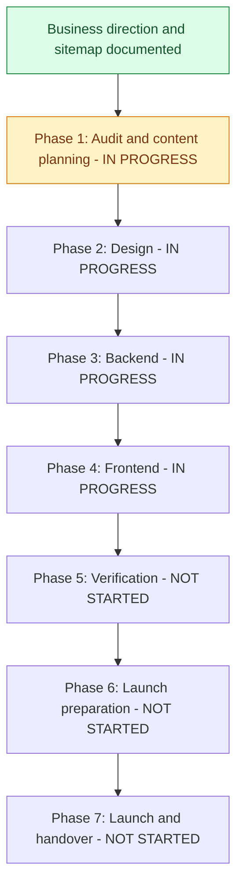

# RS Trade International: restructuring progress

Last updated: 2026-10-24 (Asia/Dhaka).

Source plan: [Website restructuring plan](restructuring-plan.md).

This file is the single place for progress and pending information. Separate review and content-checklist files are no longer used.

This is the ongoing tracker for the full website restructuring. Planning decisions are recorded separately from implementation: documenting a feature does not mean it has been built or verified.

## Current position

**Current phase:** Ready Stock ordering and shared admin improvements, alongside unfinished corporate-page content.

**Completed:** Business direction, service list, order approach, full door-to-door responsibility, restructuring roadmap and planned sitemap have been documented.

**Next:** Apply the pending orders migration when the owner is ready, then manually review cart/Buy Now submission, customer contact details in Admin > Orders, confirmation stock deduction and cancellation. Continue collecting Projects, About Us and Contact content. Service inquiries are now implemented, pending migration and manual review. Online payments remain deferred.

**Implementation status:** Corporate pages, shared admin design and database-backed Ready Stock are implemented. Account carts sync through authenticated requests; selected cart products and Buy Now now submit orders with saved delivery details and customer phone numbers. Orders retain product/price snapshots, have unique references, and appear in admin for follow-up and fulfilment. Submission does not deduct or reserve stock. Admin confirmation validates and deducts stock; pre-shipment cancellation restores deducted stock once. Saved addresses sync to accounts and appear on admin User pages. Service quotation forms now submit validated inquiries to service-specific admin sections. The new service-request and notification migrations remain pending owner application. No online payment is enabled.

## Visual roadmap

If the Markdown viewer does not render Mermaid, use the phase table and checklists below. Phases can overlap when dependencies permit; the diagram shows the main sequence.

## Phase status

| Phase | Status | Completion requirement |
| --- | --- | --- |
| 1. Audit and content planning | In progress | Audit, sitemap/content inventory and scope review complete |
| 2. Design | In progress | Mobile/desktop layouts and visual direction agreed |
| 3. Backend | In progress | Product, content and inquiry flows implemented and verified |
| 4. Frontend | In progress | Planned pages and customer journeys implemented |
| 5. Verification | Not started | Relevant checks pass and material issues are resolved |
| 6. Launch preparation | Not started | Content, SEO, hosting, tracking and operations ready |
| 7. Launch and handover | Not started | Approved site published and management instructions delivered |

Status vocabulary: **Not started / In progress / Waiting for input / Complete**. Mark a task complete only when its stated outcome exists and any required verification has passed. Do not use speculative percentages.

## Phase 1 - Audit and content planning

- [x] Confirm corporate website plus small Ready Stock business model.
- [x] Confirm audience: wholesalers, importers, businesses and individual buyers.
- [x] Confirm English as the main website language.
- [x] Confirm four services and the Source -> Verify -> QC -> Ship -> Deliver journey.
- [x] Confirm initial 5-10 Ready Stock products and WhatsApp/phone order confirmation.
- [x] Confirm no online payment integration in the current scope.
- [x] Confirm complete door-to-door handling responsibilities.
- [x] Record the full restructuring roadmap in the source plan.
- [x] Document the full planned sitemap, page sections and proposed routes.
- [x] Create this progress tracker.
- [x] Audit existing pages, APIs, models, integrations and deployment configuration (source review; runtime checks pending).
- [x] Identify reusable features, demonstration content and migration requirements.
- [x] Review cart, checkout and account dependencies before changing navigation/routes.
- [x] Create a page-by-page content inventory with available/missing information.
- The useful findings and missing information are kept below; separate review documents were removed at the owner's request.
- [ ] Finalize static-export publishing/rebuild workflow or alternative Next runtime architecture.
- [ ] Review logo, brand colors and design preferences.
- [ ] Review the planned sitemap and finalize implementation scope/routes.

## Phase 2 - Design

- [ ] Define shared typography, colors, spacing and buttons.
- [x] Apply shared blue/yellow/neutral colors to the existing website; white navigation and yellow main inquiry actions.
- [ ] Review colors visually on mobile and desktop.
- [ ] Design desktop/mobile navigation and footer.
- [ ] Design desktop/mobile homepage and its planned sections.
- [ ] Design service overview and service detail template, including prominent QC.
- [ ] Design Ready Stock listing and product details.
- [ ] Design About Us, Our Work and project details.
- [ ] Design FAQ, Contact, quotation form and policy layouts.
- [ ] Review mobile contact actions, readability and accessibility.
- [ ] Review and agree the visual direction before full implementation.

## Phase 3 - Backend

- [ ] Plan safe schema migrations for existing product records.
- [ ] Add MOQ, request-price mode and delivery information.
- [ ] Review pricing/deal validation and product image support.
- [ ] Implement inquiry storage with service/product context and source page.
- [ ] Build inquiry storage/API in a future backend phase.
- [ ] Apply inquiry migration to the configured database after confirming its environment.
- [ ] Add product context when real Ready Stock inquiries are connected.
- [ ] Implement server-side validation, spam protection and submission limits.
- [ ] Add inquiry statuses and staff notes in a future backend phase.
- [ ] Configure inquiry email notifications and failure handling.
- [ ] Build email notifications and retry handling in a future backend phase.
- [ ] Verify real recipient/SMTP delivery after database setup.
- [ ] Implement required company/project content administration.
- [ ] Decide whether service copy and FAQs require editable admin records.
- [ ] Configure staff permissions and verify backend/API behavior.

## Phase 4 - Frontend

- [x] Modernize the Django admin dashboard and shared admin theme with the website's blue/yellow/white palette, All available management options appear directly as compact cards grouped under Catalog and Accounts, with direct Manage/View and Add actions. Kept the simple heading, comfortable side spacing, yellow View website button and one Recent Activity section on the right. Browser review remains pending.
  Compatibility fix: upgraded the local environment and requirements pin from Django 5.1.4 to 5.2.17 for Python 3.14. The old version reproduced the template-context copy error in Users and Categories. Both complete list-page requests now return 200 in isolated tests. All 13 admin/profile checks and pip dependency validation pass. Refreshed collected admin assets using isolated settings. Restart the running Django server to load the new package; live browser recheck remains pending. Production database and migrations were untouched; database tests used a disposable in-memory SQLite database.
  Follow-up: the owner's screenshot showed new HTML with the older CSS. The localhost CSS response matches the updated source. Added a versioned stylesheet URL to refresh browser caches and explicit 25px icon dimensions to prevent oversized icons if CSS is unavailable. Isolated admin checks passed; visual recheck remains pending.
- [ ] Implement shared corporate layout, navigation and footer.
- [x] Implement responsive navigation, Services dropdown and Request a Quote link.
- [x] Redesign Sign In with the shared brand style, labelled fields, password visibility, loading/error feedback and existing account links.
- [x] Redesign Sign Up to match the simple Sign In card, with labelled fields, password visibility, verification guidance and compact social options.
- [ ] Review Sign Up on mobile/desktop and verify live account creation and email delivery separately.
- [ ] Review Sign In on mobile/desktop and verify live authentication separately.
- [ ] Review navigation in a browser on mobile and desktop.
- [ ] Replace the shop-focused homepage with the planned corporate sections.
- [x] Build the first homepage design with hero, process overview, four services, QC, door-to-door, Ready Stock link, FAQs and quotation links.
- [x] Move existing shopping homepage content to `/ready-stock` without deleting its components.
- [ ] Review homepage design on mobile and desktop; add genuine evidence and approved content when available.
- [ ] Implement About Us and services overview.
- [x] Implement initial China Product Sourcing page (introduction, support, process, checklist, related services, FAQ and inquiry links).
- [ ] Review sourcing page on mobile/desktop and connect it to the working quotation form when built.
- [x] Implement initial Supplier Verification page (checks, process, customer checklist, related services, FAQs and inquiry links).
- [ ] Review Supplier Verification on mobile/desktop and connect the quotation form when built.
- [x] Implement initial Quality Control & Inspection page with the six-step process, reporting details, customer checklist and FAQs.
- [x] Implement initial Shipping & Door-to-Door Import page with full handling, process, shipment checklist and FAQs.
- [ ] Review QC and shipping pages on mobile/desktop and connect the quotation form when built.
- [x] Implement initial static Ready Stock listing and individual product pages.
- [x] Redesign the initial static Ready Stock listing with search, sorting, product previews and an ordering guide; no public categories.
- [x] Replace product preview dialogs with six dedicated `/product/[id]` pages and an accessible enlarged-image dialog with zoom controls.
- [x] Add clearly labelled demo BDT prices, quantity-based subtotals and full-screen image zoom with hover, drag, wheel and pinch controls. Real prices and browser gesture review remain pending.
- [x] Add multiple saved profile addresses with edit/remove/default controls, delivery selection in Buy Now/checkout and a return path through Profile or Sign In. Browser storage only; server synchronization remains future work.
- [x] Connect quantity selection, browser-persisted cart, cart badge, independent Buy Now selection and order-request review.
  The cart badge counts different products, not total units: one product with quantity five shows 1. Cart and order-review quantities still show the requested units.
- [ ] Add approved Ready Stock products, price/MOQ/quantity details and business contact actions.
- [ ] Review Ready Stock on mobile and desktop with real product content.
- [ ] Implement product-aware WhatsApp links and phone actions.
- [ ] Implement Our Work and individual project pages.
- [x] Build the initial Projects page at `/our-work` with category filters, expandable photo stories and external video links.
- [ ] Add owner-supplied photos/stories and YouTube/Facebook URLs, then review populated cards on mobile/desktop.
- [ ] Build separate project detail pages later if needed; stories currently expand inside the listing.
- [ ] Implement FAQ and Contact pages.
- [x] Implement static quotation form with editable fields, service preselection and multiple-service selection; submission disabled.
- [ ] Connect and verify quotation submissions when the backend phase is authorized.
- [ ] Implement approved Privacy Policy and Terms pages.
- [ ] Integrate genuine approved content; withhold unavailable evidence sections.
- [x] Remove old category/product routes and unused shopping presentation components after dependency review; retain cart, buy-now and checkout for future use.
- [ ] Preserve useful URLs or implement redirects for replaced routes.

## Phase 5 - Verification

- [ ] Verify all planned pages, links and navigation.
- [ ] Verify mobile and desktop customer journeys without mandatory login.
- [ ] Verify product MOQ, stock, pricing mode and delivery information.
- [ ] Verify WhatsApp product context and confirmed phone numbers.
- [ ] Verify inquiry validation, persistence, feedback and notification delivery.
- [ ] Verify admin content management and permissions.
- [ ] Check accessibility and optimize media/page loading.
- [ ] Run appropriate frontend production build and backend checks.
- [ ] Resolve material defects and review final business claims/content.

## Phase 6 - Launch preparation

- [ ] Confirm production domain, hosting and business mailboxes.
- [ ] Finalize quotation inclusions, shipping details and applicable order terms.
- [ ] Add unique titles/descriptions, canonical URLs and internal links.
- [ ] Add sitemap, robots configuration and verified structured data.
- [ ] Verify replaced-URL redirects.
- [ ] Configure Analytics and verify successful inquiry/contact events.
- [ ] Verify Search Console ownership and submit sitemap.
- [ ] Review HTTPS, secrets, production settings and dependency maintenance.
- [ ] Configure database/media backups and verify restoration procedures.
- [ ] Complete launch checklist and prepare the concrete site for publication review.

## Phase 7 - Launch and handover

- [ ] Obtain publication approval for the completed site.
- [ ] Deploy and verify live pages, forms, contact links and admin access.
- [ ] Verify live email delivery and tracking configuration.
- [ ] Provide product, content and inquiry management instructions.
- [ ] Record maintenance, backup and support responsibilities.
- [ ] Record deployment details and outstanding follow-up work.

## Pending information and dependencies

### What we learned from the existing website

- We can reuse the product admin area and existing product storage.
- Original product and checkout demo content has been replaced. Dedicated product pages, cart, Buy Now and checkout now share the current Ready Stock catalog and quantities. Products now load from admin records; real catalog content and direct contact actions still need owner review.
- Some menu/footer links do not lead to built pages yet.
- We need a form that saves customer inquiries and notifies the team.
- We need to decide how adding a product in admin creates its public page. The current setup builds pages before publication.
- Existing product records and staff access should be preserved.
- Live email, hosting, backups and customer journeys still need checking.

These items await business content or account access; they do not prevent independent audit/design work.

| Item | Needed for | Status |
| --- | --- | --- |
| Logo/colors and visual preferences | Design | Awaiting review/input |
| Approved company/China-presence details | About, homepage | Awaiting content |
| Phone, WhatsApp, offices and hours | Contact actions | Awaiting confirmed details |
| Domain and active professional email | Email/launch | Awaiting confirmation/setup |
| Trade license details for publication | Credentials | Awaiting approved details |
| Initial products, photos, MOQ, prices and quantities | Ready Stock | Awaiting content |
| Real visits, inspections, projects and permitted feedback | Our Work/trust sections | Awaiting content |
| Shipping pricing inclusions, timelines, coverage and restrictions | Shipping details/terms | Awaiting details; full handling confirmed |
| Service and ready-stock terms | Policies/order information | Awaiting details |
| Hosting, Analytics and Search Console access | Launch preparation | Awaiting access when needed |

## Next work queue

Product publishing: in Admin, add or edit a product, choose its category, upload an image, enter the BDT price and available stock, then set Status to Active and save. Its category and optional subcategory must also be active. Draft/Archived products stay private. Refresh Ready Stock to see saved changes. Updating products does not require another frontend build. Production migrations remain pending where previously requested; this catalog connection needs none.

Future admin features: register each new model with Django admin using `admin.site.register(...)` or `@admin.register(...)`. The main dashboard will automatically show its card, and its list will inherit the shared design and 25-row paging. Set that model's `list_display`, `search_fields`, `list_filter` and form fields for its business needs. No separate list template or stylesheet is needed. Standard add/edit forms also inherit the shared change-form template and stylesheet, including built-in user-add forms. Standalone custom views should extend the shared admin base template.

Projects decisions: real factory photos are available from the owner but have not yet been added to the project. Show photos with stories, publish only details the owner chooses to share, use public YouTube/Facebook video links, and keep content static for now. `ui/content/projects.ts` stores stories and videos in their chosen display order; admin editing is future work. Empty states are displayed instead of invented project examples.

Current scope: database-backed products, account carts, customer order submission and admin order management. Orders require the pending orders migration before they can be saved to the configured database. No migration for this order feature has been applied to production. The service quotation page still previews fields without sending or saving service inquiries.

Ready Stock decisions: public categories remain hidden. Products come from admin records rather than hardcoded examples. Only Active products in active categories/subcategories are public; zero-stock items stay visible with ordering disabled. Any test records already stored in admin also appear if Active; no existing database records were changed. The listing supports search, featured/name/price ordering and 12-item pages. Product details use `/product/?id=<database ID>` so newly added products work with the existing static-export hosting without a rebuild. Product-specific server-rendered metadata and legacy URL redirect review remain future SEO work. Cart version 2 stores database IDs, intentionally leaving old demo selections separate. Cart and Buy Now fetch current product details in batches and block review for unavailable items or excessive quantities. Account cart persistence is implemented in code using authenticated /api/cart/ requests. Guest selections merge on sign-in, retries cannot add twice, and sign-out clears active account selections. Buy Now stays a separate browser selection per account. Addresses remain saved separately per signed-in account on this browser and do not sync across devices. Checkout now submits selected products as an order awaiting phone confirmation. Stock is deducted only after admin confirms the order. Prices, recipient, phone, email and delivery address are saved as snapshots; delivery charges are confirmed separately. The orders migration is still pending. Official WhatsApp/phone actions, MOQ and delivery details still need confirmed information.

Cleanup decisions: old category/product demo content and unused presentation components were removed. The old six demo product routes have been replaced by the database-backed `/product/?id=...` page, with cart/add-to-cart, buy-now and checkout connected to database selections. The navbar has a cart icon. Existing account pages, `profileModal.tsx`, Django backend and product/category records are preserved. The layout uses the shared `reduxInitializer.tsx`. Old `/category_details` and former `/product/product1` style URLs remain removed; review redirects for published URLs before deployment. Unused picture files are preserved in unused-pictures.zip; current public product pictures remain.

1. Review Projects and the four services; continue the remaining static corporate pages.
2. Collect company details, real contact information, products and photos using the pending-information table above.
3. Apply the account-cart migration when ready and manually review the flow, then review old product URL redirects and product-specific SEO.

## Update rules

Update this file when a meaningful part of the restructuring is completed, such as navigation, homepage, a service page or inquiry handling. Small adjustments belong in that part's existing entry; do not add a new log entry for every height, color or spacing change.

1. Check its task box after verifying the outcome.
2. Update phase status, current position and the visual roadmap if a phase changes.
3. Update pending dependencies and the next work queue.
4. Add a dated activity entry with what changed and verification evidence or a file reference.
5. Update the last-updated date. If scope changes, update the source plan as well.

For incomplete work, leave the box unchecked and record the current state or dependency. Keep completed planning separate from completed code. Add newly discovered tasks to the relevant phase rather than silently omitting them.

## Completed milestones

Current palette: blue for links/highlights, yellow for main actions, white/light gray for page surfaces and charcoal for text/footer. Red and green are used for meaningful error/success states. Shades are inspired by the supplied logo screenshot; they are not exact samples from the original logo. Existing logo artwork has not been replaced.

Navigation follow-up (2026-10-05): restored Sign In beside the desktop quotation button and in the mobile menu. It links to the existing `/accounts/signin` page. TypeScript and navigation lint passed; authentication behavior was not changed.

Account navigation follow-up (2026-10-07): the navbar now uses ProfileModal on desktop and mobile. Signed-in visitors see their name with My Profile and Sign Out; guests see Sign In. Updated the restored menu to the shared palette, added outside-click/Escape dismissal and a fallback when the user's name is missing. TypeScript, changed-component ESLint and simulated guest/signed-in rendering checks passed. Live social sign-in still needs a browser check; no OAuth or backend changes.

| Date (Asia/Dhaka) | Meaningful part | Result and checks |
| --- | --- | --- |
| 2026-10-15 | Account cart implementation - migration pending | Added AccountCart and idempotency receipts with authenticated GET/POST /api/cart/. Server validates product availability, stock, quantities and the 100-product limit, serializes mutations per account and ignores repeated operation IDs. Frontend keeps guest carts, transfers their selections on sign-in, queues account updates with browser recovery, refreshes saved selections when cart pages open/window regains focus, and clears private cart state immediately on logout/account changes. Added loading/saving/saved/error/retry feedback; order review waits for successful sync. Buy Now remains separate and browser-local per account. Guarded token refresh against overwriting another session. Only TypeScript, changed-source lint/Python syntax and one isolated in-memory account-isolation/idempotency/stock/migration check were run; no test files added. Migration catalog/0003_account_cart.py was created but NOT applied to the configured production database. Account syncing will remain unavailable there until the owner applies it. Frontend export was not rebuilt; use the dev server or rebuild for Django-served UI. Manual UI/device review remains pending. |
| 2026-10-15 | Catalog category cleanup | At the owner's request, retained only Electronics, Fashion and Home Appliances, with their existing products and subcategories. Removed Automotive, Beauty & Personal Care, Books & Stationery, and Sports & Outdoors: 91 products, 20 subcategories and 3 related deal-product links. Cleanup was backed up first and committed in one transaction; no cross-linked retained products were found. Remaining catalog: 3 categories, 34 products and 15 subcategories. Backup fixture: backups/catalog-before-category-cleanup-2026-10-15-4d65ee00.json (118 removed records). Backup folder is ignored by Git. Cloudinary assets were not deleted; existing deals were retained. Refresh admin and Ready Stock to review. |
| 2026-10-15 | Ready Stock loading performance | Measured the running public API: 12 products returned in about 4KB, with requests taking 10.94-16.03 seconds. Added Server-Timing headers and identified 11.49 seconds in PostgreSQL connection setup. Installed/pinned psycopg-pool 3.3.3 and enabled a bounded pool of 1-4 connections with health checks and the required CONN_MAX_AGE=0. Later measured pool checkout at 0.44 seconds and a full API response at 3.78 seconds; remote database/query latency remains variable. Removed the unconditional 250ms frontend delay from initial loading, sorting, page changes and retries; only typed search is debounced. Increased catalog request timeout to allow a cold database connection. Only essential Python syntax and TypeScript checks plus live read-only API timings were used; no test files or database migrations/data changes. Review Ready Stock manually. |
| 2026-10-15 | Test-file cleanup | At the owner's request, removed the added admin tests, isolated admin test settings, catalog tests, profile tests and frontend cart tests. Removed the cart test npm script and test-directory formatting references. Earlier test results remain in this history as records of checks performed before removal. Future work will prioritize implementation with only essential checks; the owner will review the UI and interactions manually. |
| 2026-10-15 | Database-backed Ready Stock and products | Replaced the six hardcoded demo products with public Django list/detail/batch APIs and runtime frontend loading. Only Active products in active classifications are public; no categories appear publicly. Listing has database search, featured/name/price ordering and 12-item pagination. Product details load via a generic exported /product/?id= route, retain zoom, show current BDT price/stock and use optimized HTTPS Cloudinary URLs with a neutral missing-image placeholder. Cart/Buy Now/review now use database IDs, current prices and stock checks; deleted/hidden items stay removable and block review. Browser cart key moved to v2 so demo IDs cannot become real products. Account syncing remains next. All 30 isolated backend tests, 17 cart/address/catalog tests, changed-source ESLint, TypeScript validation and production static export passed. API list uses two database queries per page in tests. Existing production records were neither read nor changed; no migration required. Live browser/API integration and real catalog content review remain pending. |
| 2026-10-15 | Cloudinary configuration cleanup | Removed repeated SDK credential mappings. Existing CLOUDINARY_STORAGE remains; the SDK reads credentials directly from environment variables and CLOUDINARY contains only secure=True for HTTPS delivery. Updated the mocked upload test to use environment credentials; all 24 isolated admin tests passed. No live upload or database changes. |
| 2026-10-15 | Cloudinary product-image preparation | Confirmed Cloudinary packages and CloudinaryField image fields already exist. Checked only whether the three root .env credentials are present; did not display values or verify them remotely. Added explicit SDK configuration using the existing environment variables with HTTPS image delivery enabled. All 24 isolated admin tests passed, including a product-add image submission with the external upload mocked, database reference persistence and HTTPS URL generation. No real upload, production database access or migration was performed. Next: restart Django and verify an actual product-image upload, then expose images through the product API. |
| 2026-10-11 | Shared modern add/edit forms | Added a shared change-form template and scoped stylesheet inherited by all standard Django add/edit forms, including the special user-add template and future registered models. Forms now have a simpler heading, Back to list action, centered layout, white section cards, two-column desktop fields with labels above controls, full-width descriptions, clearer upload buttons, styled autocomplete controls, scrollable inline tables and a yellow primary Save button with secondary save actions. Mobile fields stack into one column. Preserved native widgets, scripts, permissions, CSRF, validation, uploads and inline form management. All 23 isolated tests passed, including every registered add page, a future-feature add page and invalid/valid category-with-subcategory submission plus edit-form rendering. Static assets refreshed. Browser/mobile visual review remains pending; no production database changes or migrations. |
| 2026-10-11 | Automatic styling for future admin models | Centralized shared list design and performance defaults in configure_model_admin. Admin registration now applies these settings automatically to new models registered after site setup, including normal register calls and decorators. Dashboard cards already come from the registered model list; unfamiliar models use generic icons, descriptions and search labels. An isolated test registers a temporary future feature after setup and verifies its live list route, shared styles, fallback labels and dashboard card/add links. All 21 admin tests passed. No real model, migration or production database changes. |
| 2026-10-11 | Shared design for all admin lists | Applied the approved product-list design to Categories, Subcategories, Deals, Deal Products, Users, Profiles and Groups. Every registered management list uses a shared template and stylesheet with a model-specific heading/description, search field, white table, yellow permission-aware Add button, collapsed inactive filters and comfortable spacing. Removed the product-only template/filter/styles in favor of reusable files. Product column improvements and all existing forms, pagination, sorting, actions and performance settings remain in use. All 20 isolated admin tests passed, including actual GET requests for every registered model list and view-only Add-button protection. Collected static assets refreshed. No production database access or migrations; visual browser review remains pending. |
| 2026-10-11 | Product admin list redesign | Added a product-specific list layout with a simple Products heading, yellow Add Product button, larger labelled search field, result count, white table and properly sized price/stock/status inputs. Removed the left navigation from this list, repeated category text in subcategory cells and the date column; dates remain available on product forms. Filters start collapsed unless selected, show a highlighted selection and scroll long option lists. Existing search, sorting, pagination, bulk actions, CSRF and inline edits remain native Django behavior. Product styles are scoped to this page and loaded after shared styles. All 18 isolated admin tests passed, including filter/search parameter preservation, add links and prior query-count checks. Collected static assets refreshed. Browser/mobile visual review remains pending; no migrations or production database changes. |
| 2026-10-11 | Admin performance improvements | Removed repeated category queries from product subcategory filters and autocomplete labels. Category subcategory counts now load in one annotated query. All registered admin lists use 25-row pages, skip duplicate full-result counts and disable optional filter-count queries. Profiles use user autocomplete and email/name search instead of loading every user into a filter/form dropdown. Deal-product lists explicitly load related records together. An isolated benchmark with 250 products and 120 subcategories reduced product-list queries from 126 with the previous filter to 6 with the optimized filter. All 17 isolated admin tests passed, covering filters, pagination, inline-edit controls, category counts, profile search/autocomplete and existing dashboard/routes. No production database access, data changes or migrations. Live database/network loading time still needs browser confirmation. |
| 2026-10-11 | Product admin list performance | Found two extra database queries per product with a subcategory: an isolated list test grew from 10 to 26 queries after adding eight products. ProductAdmin now loads category, subcategory and the subcategory category together, keeping query count constant as rows increase. Limited list pages to 25 products while keeping inline edits. All 13 isolated admin tests passed using an in-memory SQLite database. Live product-list loading still needs browser confirmation; no production database access or migrations. |
| 2026-10-11 | Direct management cards | Replaced the two workspace entry cards with a responsive grid of individual management cards on the main dashboard. Every permitted model appears under Catalog or Accounts with an icon, description and direct Manage/View and Add links. Recent Activity stays on the right; heading, website button and side spacing are preserved. Removed the obsolete workspace-card template/styles and reused model descriptions across dashboard and section pages. All 12 isolated admin tests passed, covering management links, view-only visibility, existing section routes and login protection. Collected styles refreshed. No migrations or production database changes; browser review remains pending. |
| 2026-10-11 | Dashboard workspace cards | Replaced the dashboard model rows with two clickable cards: Catalog and Accounts. Catalog opens its existing admin section; Accounts opens /admin/accounts/ with users, profiles and groups together. Add and Manage options now appear inside each section. Kept one Recent Activity card on the right, the yellow View website button and current side spacing. Cards stack on smaller screens and support keyboard focus. Existing permission checks and login protection remain in use. All 12 isolated admin tests passed, including both workspace routes and simulated restricted access; collected styles refreshed. No migrations or production database changes. Visual browser review remains pending. |
| 2026-10-11 | View website button placement | Restored the yellow View website button beside the dashboard heading and removed the website link from the top navigation. On mobile the button sits beneath the heading. Kept the right-side activity card and current spacing. All 10 isolated admin tests passed and collected styles were refreshed. |
| 2026-10-11 | Recent Activity placement | Moved the single Recent Activity card to the right of Catalog and Accounts on desktop. Management cards stack in the left column; activity moves below them on mobile. Kept the centered 1680px container and comfortable side spacing. All 10 isolated admin tests passed and collected styles were refreshed; browser review remains pending. |
| 2026-10-11 | Admin spacing and activity adjustment | Restored one Recent Activity section below the management cards, showing the signed-in administrator's latest six changes. The native sidebar stays empty to prevent duplicate panels. Dashboard content is centered within 1680px with 40px desktop padding and 20px mobile padding. Kept the simpler heading and removed extra notes. All 10 isolated admin tests passed; refreshed collected styles. Browser review remains pending; no production database changes. |
| 2026-10-11 | Admin dashboard cleanup | Removed the workspace eyebrow, repeated View website button, recent activity panels and catalog note. The heading and content now use 32px desktop side spacing instead of a narrow centered container; mobile uses 20px. Catalog and Accounts sit side by side on large screens and stack on smaller screens. Removed unused activity styles and template log handling; refreshed the stylesheet version and collected static assets. All 10 isolated admin tests passed using an in-memory SQLite database. Browser review remains pending; no production database access or migrations. |
| 2026-10-10 | Admin dashboard design | Replaced the older black/teal/orange theme with a consistent light blue/yellow/white admin theme. Added a responsive dashboard with Catalog-first management cards, grouped Accounts, model descriptions, Add/Manage/View links and the current user's recent activity. Matched header branding, buttons, login, model lists, forms and sidebar to the website palette. Removed the conflicting dark-mode toggle/styles; fixed the Accounts navigation target. Existing registrations, staff permissions, CSRF-protected POST logout and model forms are preserved. Six isolated template/permission/escaping regression tests and Django system checks passed without database setup or production settings. Browser/mobile review remains pending. No model, migration or database changes; backend catalog records still do not publish the static website's sample products. |
| 2026-10-10 | Saved addresses and order delivery selection | Added a profile address book with multiple addresses, edit/remove confirmation and default selection. First address becomes default; deleting a default selects a remaining address. Address storage is validated and separated by account; unavailable storage shows a warning. Buy Now/checkout select the default, offer other saved addresses and use the chosen recipient/phone/address in the request. Missing addresses route to Profile with a Continue link back to the order; guests sign in first, including through social providers. TypeScript, changed-file ESLint, formatting, 13 cart/address/navigation/request regression tests and production static export passed. Live browser/mobile/auth return checks and cross-device address storage remain pending. No backend, database migration or payment changes. |
| 2026-10-10 | Demo prices and modern product zoom | Added owner-approved demo BDT prices to all six sample products, numeric unit prices and quantity-based demo subtotals across listing, product pages, cart and order review. Copied inquiries identify demo prices and request final confirmation. Replaced the old scrolling image popup with desktop hover magnification and a full-screen viewer supporting 100–400% zoom, drag, wheel, pinch, double-tap/reset and zoom buttons. Native dialog supports Escape/focus; body scroll restores after closing and motion controls respect reduced-motion preferences. TypeScript, component/content ESLint, six cart/pricing/request tests and production static export passed. Desktop/mobile gesture and visual review remain pending. No payment, backend or database changes. |
| 2026-10-10 | Frontend code readability | Reformatted frontend source and cart tests with consistent two-space indentation, expanded JSX/props, readable handlers and multiline objects. Added Prettier development tooling/configuration plus npm run format and format:check to maintain this style. Formatting only; intended site behavior unchanged. Format check, TypeScript, relevant component/state ESLint and all five cart regression tests passed. |
| 2026-10-10 | Product pages, zoom and connected cart flow | Replaced listing popups with six static product routes. Added native enlarged-image dialog with 100–300% zoom/reset, scroll/swipe and Escape dismissal. Added Redux cart with validated quantities, merge/update/remove/clear, localStorage persistence and navbar badge. Buy Now keeps a separate selection. Replaced old fake cart/checkout content with current catalog items and a copyable contact/delivery request; no submission or payment. TypeScript, changed-file ESLint, five cart/request regression tests and production static export passed. Browser/mobile interaction review, real stock data and official ordering contacts remain pending. No backend/database changes. |
| 2026-10-10 | Profile request follow-up | Browser reported GET /api/profile/getProfile/ returning 404; the endpoint returned 404 for accounts without a separate Profile record. It now serializes an unsaved profile with the authenticated user's name, email and sign-in method, leaving unavailable dates/photo/display name empty without database writes. Existing profiles remain intact; anonymous access stays blocked. Also corrected the frontend token-refresh guard and added distinct error messages. Three isolated backend regression tests, TypeScript, lint and six mocked frontend response cases passed. Backend tests used isolated settings with no production database access; no migration or data write performed. Live browser recheck remains pending. |
| 2026-10-10 | Profile sign-out protection | Sign Out now clears Redux user data synchronously and redirects from Profile to Sign In. Profile waits for session validation, hides private details immediately when unauthenticated, clears local profile/password state and cancels its fetch on logout. Late authentication responses are ignored after sign-out. TypeScript, changed-file ESLint and simulated logout/late-response/private-data/redirect checks passed. No backend/database changes; live browser verification remains pending. |
| 2026-10-10 | Profile page repair and redesign | Replaced the gradient profile card with the current white/blue/neutral account style and responsive details. Added profile loading, retry and expired-session messages; missing display names fall back to the signed-in account name and missing/invalid dates show Not available. Profile photos have dimensions and a fallback. Removed the nonfunctional Edit Profile button. Email accounts retain password changes with confirmation, saving feedback and visible success/errors; social accounts show provider guidance. Existing profile/password endpoints unchanged. TypeScript, component lint, mocked loading/data/error/date checks and production export passed. Live profile retrieval and password changes remain unverified; no database changes. |
| 2026-10-10 | Forgot Password submission feedback | Added a spinner and Sending reset link button state, disabled controls during requests, duplicate-submit guard and inline success/error feedback with accessible announcements. Requests time out after 30 seconds; controls recover after success or failure. Fixed the broken apostrophe text. Existing backend endpoint unchanged. TypeScript, component ESLint and mocked pending/success/failure checks passed; no live reset email sent during verification. |
| 2026-10-07 | Social sign-in loading and recovery | Replaced Google/Facebook/Microsoft callback loaders with one shared RS-branded white card, blue loading ring, plain signing-in messages and reduced-motion support. Missing/cancelled authorization, failed requests (30-second timeout) and invalid token responses show a recovery link. Stable token-save callback and one-time exchange guard prevent repeated code exchanges; leaving the page prevents late redirects. Existing endpoints and token storage preserved. TypeScript, callback lint, production export and 15 simulated provider/outcome cases passed. Real OAuth and browser review remain pending. |
| 2026-10-07 | Unused picture cleanup | Moved the 44 unused public pictures into unused-pictures.zip at the project root, recovering the previously deleted files from Git. The archive contains all 44 pictures and passes its integrity check; it can be moved elsewhere. Kept the eight images used by Ready Stock and restored cart/checkout in ui/public/images. No missing referenced pictures. Backend media and database unchanged. |
| 2026-10-07 | Old frontend cleanup and retained features | Removed 21 obsolete source files: category/product routes and components, banners, old hero/home/footer/contact blocks and old sidebar. At the owner's request, restored cart/add-to-cart, buy-now and checkout pages/components, profileModal.tsx and reduxInitializer.tsx. The layout now imports the shared initializer instead of defining a duplicate. Removed unused framer-motion and react-inner-image-zoom packages. Production build/type validation, static export and layout/account-component lint passed after restoration. Retained shopping pages remain demos outside the main navigation; profile modal is retained without changing navigation. Backend/database unchanged. Published-URL redirect review remains pending. |
| 2026-10-07 | Sign Up redesign | Matched the approved centered Sign In card: RS badge, blue accent, four labelled fields, password/confirmation visibility, yellow Create Account button, compact social icons and sign-in/website links. Existing creation endpoint, password checks, verification-email notification and redirect preserved. Form now submits through onSubmit, supports Enter and disables repeat submissions while loading. Removed unused keep-signed-in control and corrected metadata. TypeScript and changed-file ESLint passed. Browser review and live signup/email verification remain pending; no backend/database changes. |
| 2026-10-07 | Sign In redesign | Simplified to one centered white card with a blue accent, RS badge, email-first form, visible labels, password toggle and yellow sign-in button. Social options sit in a compact icon row with accessible names; signup, password recovery and return-to-website links remain. Existing login endpoint, token handling and verification preserved. Removed the unused keep-signed-in checkbox and corrected metadata. Initial production export passed; TypeScript and changed-file ESLint passed again after simplification. Browser and live authentication checks remain pending; no backend/database changes. |
| 2026-10-07 | Ready Stock redesign | Replaced the old shopping layout at `/ready-stock` with a responsive product grid, search, alphabetical sorting, product-detail dialogs, ordering guide and shared company footer. Public categories removed from this page; backend categories unchanged. Six sample items are explicitly marked as previews; price, MOQ, quantity and contact actions await real details. TypeScript, changed-file ESLint and production export passed. Browser review and real product/contact content remain pending. |
| 2026-10-04 | Website plan and progress tracking | Business model, services, full door-to-door handling, sitemap and task list recorded. Progress is maintained here. |
| 2026-10-04 | Existing website review | Identified reusable admin/product storage, example shopping features and missing pages/inquiry handling. Useful findings and pending information are kept in this file. Live checks remain pending. |
| 2026-10-04 | Navigation implementation | Main order: Home, Services, Ready Stock, Projects, About Us, Contact; Request a Quote stays on the right. Dropdown contains only the four services; the overview link was removed at the owner's request. Desktop/mobile share this order. Added mobile menu and active-page styles; removed shopping controls. Desktop height is 90px; mobile is 64px, with matching page spacing. Initial production build passed; TypeScript and component lint passed for the arrangement update. Full browser review and destination pages remain pending. |
| 2026-10-04 | Shopping content moved and first corporate homepage built | Previous home content preserved at `ui/app/ready-stock/page.tsx`. New `ui/app/page.tsx` presents services, process, QC, import support, FAQ and inquiry links. TypeScript, changed-page ESLint and production export passed, including `/ready-stock`. Browser review, real product data, evidence, service pages and quotation handling remain pending. |
| 2026-10-04 | Shared website colors | Added centralized blue, yellow and neutral shades; white header, light QC/contact sections, charcoal footer, yellow primary inquiry/account actions. Replaced orange shopping accents and account gradients. TypeScript, homepage/navigation/theme lint and production export passed. A final input-background correction was made after the build; visual review remains pending. |
| 2026-10-04 | Initial China Product Sourcing page | Built `/services/china-product-sourcing` with the agreed sections, shared company footer, page title/description and service-specific quotation links. TypeScript, page/footer lint and production export passed. Quotation form and related service destinations are still pending; no negotiation/sample promises or fabricated evidence added. |
| 2026-10-04 | Initial Supplier Verification page | Built `/services/supplier-verification` with supplier identity/business/capability information, four-step process, customer checklist, related services, FAQs and service-specific quotation links. Shared palette/footer and page title/description included. TypeScript, page lint and production export passed. Browser review, quotation handling and final operational content remain pending. |
| 2026-10-04 | Initial QC and Door-to-Door Import pages | Built `/services/quality-control` and `/services/door-to-door-import` with shared service layout, six-step processes, checklists, FAQs, related services, metadata and quotation links. All four service destinations now exist. TypeScript, changed-file lint and production export passed. Browser review, quotation handling, real evidence and final business terms remain pending. |
| 2026-10-05 | Static quotation page | Built `/request-a-quote` with service preselection, multiple selections and editable fields. Submission is disabled with a clear notice. Backend additions were removed after the owner deferred backend work; no production database changes. TypeScript and changed-file lint passed for the static version. |
| 2026-10-05 | Initial static Projects page | Built `/our-work` with shared colors/footer, three project categories, filters, expandable photo stories and YouTube/Facebook link support. No fictional entries: real content is pending in `ui/content/projects.ts`. TypeScript, changed-file lint and production export passed. Populated gallery/browser review and actual media remain pending; no backend added. |

### Cart model name
Renamed the model from AccountCart to Cart and updated the cart API references. Migration 0004_rename_accountcart_cart preserves existing cart data whether migration 0003 was already applied or is still pending. The new migration has not been applied to the production database. Apply pending catalog migrations before using account carts.

### Cart in the admin dashboard
Registered Cart with the shared admin design. Staff with view permission can search customer email, see distinct product counts and last update time, and open saved cart selections. Cart records are view-only so admin edits/deletions cannot interfere with cart syncing and retry receipts. Cart operation receipts remain internal. Pending catalog migrations still need applying; no production migration was run.

### Django-served cart build refreshed
Investigated carts missing from admin: read-only checks confirmed migrations 0003 and 0004 are applied, Cart is registered, and there were zero saved cart records. The previous ui/out export predated account-cart syncing and contained no /api/cart/ requests. Rebuilt the frontend export successfully so Django now serves account-cart code; confirmed /api/cart/ is present in the generated JavaScript. No customer cart records were created or changed during diagnosis. Manual signed-in add-to-cart and admin review remain pending. Guest carts stay browser-only until sign-in.

### Readable admin cart and product IDs
Replaced raw cart JSON with a full-width product table: linked product names, product IDs, SKU, quantities, current BDT unit prices, line totals and stock/publication warnings. Added product/unit/subtotal summary cards and readable empty/deleted-product states. Cart details stay view-only, and prices explicitly reflect the current catalog rather than an order. Product admin now shows read-only IDs on detail pages and an ID column in the list, with ID search. Updated shared view-only page wording. Django system check and a small template-render check passed; no test files, database edits or migrations were needed. Manual visual review remains with the owner.

### 2026-10-16 - Admin details before editing
All registered admin records now open a shared details page when selected from a list. Grouped saved fields, record IDs, related inline records and uploaded Cloudinary/image previews are displayed without edit widgets. A pencil Edit button opens the existing form only for staff allowed to edit; carts remain view-only. Added image enlargement links, History, Back to list and View details navigation from edit forms. Save and continue editing remains in edit mode. Popup widgets and normal POST validation keep Django handling. Future models automatically inherit this through the shared admin registration setup. Passwords and credential fields are omitted from previews. Django system check and small read-only rendering checks passed for saved Cart, Category, SubCategory, Product, Deal, DealProduct, User and Profile records; Product edit form and HTTPS image URL also checked. No database records changed, no migrations or test files added. Manual visual review remains pending.

### 2026-10-16 - Edit directly inside admin details
Replaced navigation from the pencil button with an in-place editor on the same details page. Images/header stay visible while the saved fields switch to native Django widgets, including image uploads, autocomplete and related inline forms. Added Save changes and Cancel at the top/bottom, saving feedback, duplicate-submit protection and unsaved-change confirmation. Save uses the existing permission checks, CSRF protection, validation and inline saving; success returns to the current record details and invalid submissions keep edit mode open with field errors. View-only carts have no embedded editor. Avoided repeated record lookups when preparing the editor. Essential Django/JavaScript syntax and small read-only rendering/invalid-submission checks covered Product, Category, Profile, User and Cart. No data changes, migrations or test files added. Manual browser interaction review remains pending.

### 2026-10-16 - Modern admin section pages
Catalog, Accounts and future section pages now reuse the dashboard's responsive management cards instead of long full-width rows. Simplified the section heading, removed the duplicated visible group heading, added Back to dashboard, and retained permission-aware View/Manage/Add links. Added distinct cart/category/subcategory icons and a clearer cart description. Recent activity stays on the main dashboard only. Small read-only render checks passed for Catalog and Accounts; no database changes, migrations or test files added.

### 2026-10-16 - Consistent admin card heights
Set shared management cards to a consistent minimum height, equal grid-row sizing and equal action-area height so Catalog and Accounts cards align, including view-only Carts. Content can still grow without clipping on narrow screens. Updated the stylesheet version for browser refresh. No tests or database changes needed for this CSS-only adjustment.

Admin card spacing refined: reduced minimum height from 244px to 208px, padding to 18px, and description/action spacing while retaining equal grid rows and bottom-aligned actions.

Admin cards made slightly more compact: 188px minimum height, 16px padding and tighter description/action spacing. Equal grid rows and bottom-aligned controls retained.

Admin cards reduced in both dimensions: four columns on wide screens, scaling to three/two/one on smaller screens; 176px minimum height, 14px padding and smaller icons. Cards retain equal rows and readable controls.

Aligned dashboard Catalog and Recent activity headings by placing both above their cards with shared heading spacing and line height. Both card sections now begin at the same level on desktop; the activity section remains stacked below on mobile.

Catalog and other section pages now use the same card-area width as the admin home, preserving its right-side column space on desktop so shared card widths and heights match at the same screen size. Mobile continues to use the full available width.

### 2026-10-16 - Missing and broken admin images
Added a shared branded image placeholder using the record's initials, a soft blue background and clear loading/empty/unavailable messages. Empty image fields now show this preview rather than a plain field message. Image load failures keep the placeholder and disable enlargement; valid images reveal normally with enlargement links. Applied to main and related-record previews, including view-only detail pages. Uses browser load/error events without network probes or database changes. Essential Django/JavaScript and in-memory template checks passed; no test files added. Manual visual review remains pending.

Catalog and other section pages now use the full available width rather than reserving an empty activity column. Shared card grids automatically fit as many roughly 280px-wide cards as the available area allows, preserving compact height and responsive wrapping. Home retains its actual Recent activity sidebar. This replaces the previous empty-column approach to matching card size.

### 2026-10-18 - Select products in the cart
Added individual product checkboxes and Select All with partial-selection indication. Summary totals, stock checks and checkout request contents use only selected products; unchecked products remain in the cart and at least one selection is required to continue. Existing/newly added products start selected. Selection preferences are stored per account in this browser (guest selections transfer on sign-in) and survive cart refreshes; account cart products continue syncing normally. Buy Now remains independent. Selecting products does not change backend cart data or the navbar's distinct-product count. No database migration or test files needed. Changed-source lint passed; frontend rebuild includes TypeScript validation and refreshes Django's exported UI. Manual UI review remains pending.

### 2026-10-20 - Customer orders and admin follow-up
Implemented an Orders app with immutable customer/delivery/product/price snapshots, customer notes, unique order references and authenticated creation/receipt/retry-lookup APIs. Selected cart products or Buy Now can be submitted from checkout; server validates current stock, price, phone and address. Repeated requests return the same order. Submitted cart quantities are removed without clearing unselected items. The browser keeps an interrupted submission's request ID so retries/reloads can recover the existing receipt. Customers see an order number and the phone the team will call. No message or email is sent automatically, and no online payment is taken.

Admin > Orders includes phone links, search by order number/name/email/phone, status filters, saved product images/prices, address, internal call/fulfilment notes, shared details/in-place editing and native admin history. Order snapshots cannot be edited and orders cannot be added/deleted from admin; cancellation preserves the record. Statuses cover awaiting phone confirmation, contacted, confirmed, processing, shipped, delivered and cancelled.

Final stock decision: do NOT reserve or deduct stock on submission. Admin confirmation locks the order/products, rejects insufficient stock and deducts once. Cancellation before shipment restores deducted stock once; cancelling an unconfirmed order does not alter stock. Shipped/delivered orders cannot be cancelled through this workflow. Pending requests do not guarantee stock availability.

Essential checks: Django system/migration consistency checks; one isolated in-memory check for submission, stock unchanged before confirmation, idempotency, account isolation, selected-cart cleanup, confirmation deduction, insufficient-stock rejection, cancellation restoration and admin rendering. No test files or production order/customer records were created. Frontend lint/type checks passed; frontend export rebuilt successfully for Django. Migration orders/0001_initial.py remains PENDING: owner must apply it before live orders can save. Manual UI/phone workflow review remains pending.

### 2026-10-20 - Direct order follow-up controls
Orders now show the status selector and admin notes directly in the Follow-up section, with a local Save follow-up button. Removed the order pencil/full-record edit mode; other admin features keep their existing edit flow. The overview shows a read-only current status and customer/product/order snapshots remain protected. Saving uses Django's existing permissions, CSRF, validation, admin history and confirmation/cancellation stock logic, then returns to Follow-up. Validation errors stay beside the controls. Essential Django checks and an isolated in-memory render/save/invalid-status check passed, including confirmation stock deduction. No live records changed, no migration or test files added.

Removed the automatically generated Record information card that only repeated the ID. The record ID remains in the details header; IDs explicitly included in a feature's own fieldsets remain available. Shared admin details now start with the meaningful feature overview.

### 2026-10-20 - Profile phone validation
Added shared frontend phone validation to the address form and Redux save action, with phone-field blur/save errors and international-format normalization. Bangladesh mobile numbers accept local 01-format or +880; other international numbers require + and a country code. Rejects letters, misplaced plus signs, malformed parentheses/separators and invalid digit lengths. Existing saved addresses are not deleted: invalid numbers are flagged for editing. Checkout blocks invalid selected phone numbers and backend order delivery validation enforces matching formatting rules. Essential representative format/normalization checks passed on frontend/backend, along with changed-source lint and Django checks. No database migration or test files added. Frontend export rebuilt for the Django-served UI; manual profile/checkout interaction review remains pending.

Removed Joined and Last updated from the customer profile page at the owner's request, along with the unused date-formatting helper. Account name, email, sign-in method, security and addresses remain displayed. No database changes needed.

### 2026-10-20 - First and last name in profile
Added separate first_name and last_name account fields, a profile Edit name form and an authenticated own-account PATCH endpoint. First name is required; last name is optional. Compound names are preserved in their selected fields and the combined name remains compatible with existing signup, account labels and order history. Saving updates the profile heading and navbar immediately. New account creation initializes the fields from the supplied full name; migration 0012_user_first_last_name backfills existing names by taking the first word as first name and the remaining words as last name, preserving the original combined name until edited. Users can correct that split in the profile. Admin displays both fields and keeps them synchronized when an existing full name is edited. Removed plaintext password debug logging in the touched authentication/profile handlers. Essential migration/validation/account-isolation checks passed in an isolated in-memory database, along with Django checks and changed-source lint. No test files or live database changes. The users migration remains PENDING and must be applied before using the updated account/profile code. Frontend export rebuilt; manual name-save/navbar review remains pending.

### 2026-10-20 - Separate password settings page
Moved the inline profile password form to /accounts/change-password/. The profile now shows a compact Change password link with an arrow under Account security. The dedicated page includes current/new/confirm password fields, mismatch errors, saving/success feedback and links back to the profile, using the existing authenticated password endpoint. Guests return to sign-in; social accounts receive provider-specific guidance. Requests abort on navigation, sign-out or account changes. Changed-source lint and frontend build/type checks passed; Django-served frontend export rebuilt. No backend, database, migration or test-file changes. Manual interaction review remains pending.

### 2026-10-20 - Profile layout refresh
Replaced the narrow stacked profile with a wider responsive account layout: a compact identity header with photo/initials, personal details with an aligned Edit name action, and a separate security panel linking to the dedicated password page. Name fields use subtle inset backgrounds; email is grouped with personal details and sign-in method with security. Saved addresses remain below, using the available page width. Mobile panels stack. Existing profile fetching, account guards, name editing and address behavior remain connected. Changed-source lint and production build/type checks passed; frontend export rebuilt for Django. No backend, migration or test-file changes; manual UI review remains pending.

Profile personal details and security panels now stretch to equal height in their shared desktop grid, with natural heights when stacked on mobile. Frontend export rebuilt; no database changes.

Profile name labels and their values now appear inline within each name field, replacing the label-above-value layout. Frontend export rebuilt.

Fixed password settings misclassifying legacy Email accounts as social logins: normalize sign-in method casing/whitespace and reject unknown methods as a load error. Corrected UserManager's default to lowercase email for future accounts. Existing records need no migration. Changed-source lint and frontend build/type checks passed; frontend export rebuilt.

### 2026-10-20 - Customer order history
Added /accounts/orders/ with authenticated, own-account order history, 10 orders per page, current status badges, expandable product snapshots/images, delivery details, customer notes, staff customer updates, last-updated time and manual refresh. Linked from the account menu, profile and order confirmation. Added a customer_update field to the order Follow-up form; private admin_notes remain excluded from all customer responses. Existing confirmation/cancellation stock rules are unchanged. Migration orders/0002_order_customer_update is PENDING for owner application. Essential in-memory checks passed for pagination, guest rejection, cross-account isolation, private-note exclusion, customer updates, admin form and no-store caching. Django/migration consistency checks, changed-source lint and frontend build/type checks passed; export rebuilt. No test files or live database changes; manual interaction review pending.

Diagnosed My orders 503 with a read-only migration-status check: orders/0002_order_customer_update remains unapplied. Owner must run python manage.py migrate orders. Improved customer error feedback so 503 shows temporary-unavailability and Try again; Sign in appears only for 401. Changed-source lint/build passed; no live database writes.

### 2026-10-20 - Unified admin feature grid
Removed app-specific Catalog/Orders/Accounts groupings from the admin dashboard. All permitted model cards now render in one continuous responsive grid under All features, with the existing card sizes/actions and right-hand Recent activity retained. Future registered models use the same loop automatically; individual app pages retain their scoped cards. Admin templates compiled successfully. Template-only change; no frontend rebuild, database changes or test files needed.

Removed the All features heading from the unified admin card grid at the owner's request.

Fixed low-contrast text in the chosen-permissions blue header on admin add/edit forms. Scoped white text to the selector heading, label and help text; bumped shared form stylesheet version on add/edit and details templates. No database changes or frontend build needed.

### 2026-10-20 - Shared modern delete confirmations
Redesigned Django admin single-record and bulk-delete confirmations globally with a centered layout, no sidebar, contextual back link, warning panel, deletion-count summary tiles, scrollable related-record list and consistent Cancel/Delete actions. Shared partials and scoped admin_delete.css apply automatically across existing/future admin features using Django's standard templates. Native breadcrumbs, media/cancel script, CSRF, selected-object POST fields, popup/to-field handling, permission restrictions and protected-related-record states remain intact. Essential read-only template rendering checks passed for single/bulk and blocked-deletion branches; no records deleted, database changes or test files added. No Next.js rebuild needed.

### 2026-10-20 - Richer admin profiles
Expanded Profile admin details into User account, Profile, Sign-in and access, Orders and Profile record sections. Displays linked full/first/last names, email, user ID, normalized sign-in method, verification/staff/superuser flags, last recorded sign-in and profile timestamps, plus a user-filtered order-history link. Account data is read-only here and remains managed through the linked User record. Listing shows user/full name/sign-in method/verification/update time and searches first/last names. Related user loads via select_related for list/details; add form remains focused on creating the Profile. Django system check passed. No database migration, frontend build or test files needed.

### 2026-10-20 - Consolidated Users administration
Removed standalone Profile admin registration so Profiles no longer appears as a separate dashboard feature. User detail/edit pages now include linked display name, photo and profile timestamps through a one-to-one inline, alongside user ID/email/names, sign-in method, verification/access flags, recorded last login and user-filtered order history. Existing linked profiles are preserved; users without one can add the additional details from the same editor. User queryset selects the profile; first/last-name search retained. Django check and focused in-memory admin integration checks passed for existing/missing profiles, detail context and inline editor; no live database writes, migrations or test files added.

### 2026-10-20 - Account-synced saved addresses
Added userProfile.Address with per-user references/default uniqueness and authenticated own-account address-book GET/import/save/default/delete endpoints. Mutations serialize through a user lock; save validates delivery phone/address fields and defaults fall back after deletion. Browser addresses import once per browser/account without overwriting existing server edits or defaults, preserving legacy invalid phone values for user correction. Redux now hydrates from the server; localStorage is an optional cache. Profile edits wait for backend confirmation, show retry/errors, abort on unmount and reuse references after interrupted saves; checkout reports address-load failures. Saved addresses appear read-only on the admin User page with recipient, phone, full address, default and update time, including an empty state. Shared details honors inline labels and configurable item limits. Essential in-memory CRUD/isolation/import/default/admin-render checks passed; Django/migration checks and changed-source lint passed. Frontend export rebuilt. No test files or live database writes. Migration userProfile/0003_address remains PENDING; owner must run python manage.py migrate userProfile. Existing browser-only data appears in admin after customers sign in on the browser holding that data; manual interaction review pending.

### 2026-10-20 - Compact admin saved addresses
Replaced expanded address field grids with compact two-column expandable cards inside a height-limited, keyboard-scrollable region. Labels/recipients/locations remain visible; opening a card reveals phone, full delivery address and update time. Default address starts expanded. Mobile uses one column; all addresses remain accessible by scrolling. Scoped custom inline details template leaves other admin features on their existing layout. Address/empty template render checks passed, no database changes or frontend rebuild needed.

Aligned Operations Dashboard and Recent activity in the same desktop grid header row, with feature cards/activity list starting together in the second row. Visit website remains beside the dashboard heading. Mobile keeps the dashboard/cards before the activity heading/list. Bumped dashboard stylesheet version; template compilation passed. No database changes or frontend build needed.

### 2026-10-20 - Admin order/cart notifications
Added a notification bell across authenticated admin pages with persisted per-staff unread counts, latest-40 feed, order/cart filters, links to detail pages, individual read handling and Mark all as read. Visible admin tabs poll every 30 seconds (60-second error backoff); new orders arriving during the session also show an accessible on-page toast. New-order alerts are created in the order transaction, with idempotent submission retries producing no duplicates. Actual cart changes coalesce to one alert per cart; unchanged operations/retries remain quiet, empty carts and checkout remove obsolete cart alerts. Updating a previously read cart makes it unread again. Staff-only endpoints honor model-view permissions, use no-store responses and CSRF-protected writes; timestamps protect unseen newer updates from stale mark-read requests. Missing migrations display an availability message. Essential in-memory workflow checks passed for order/cart creation, transaction rollback, duplicate/no-op suppression, checkout cleanup, staff read isolation/stale-read handling, staff access/CSRF, admin rendering and unchanged submission stock. Django/migration consistency and JS syntax checks passed. No test files, live database changes, emails or external messaging. Migration notifications/0001_initial is PENDING; owner must run python manage.py migrate notifications before using the updated order/cart flow. Existing historical orders are not backfilled as new alerts. Manual notification interaction review pending.

### 2026-10-20 - Dashboard Orders/Carts counters
Added compact numeric badges to Orders and Carts feature cards: total orders and active (non-empty) customer carts. Counts respect each model admin's view permission/queryset and update from the existing notification poll every 30 seconds, including zero values. Header badges share current card sizes; bumped CSS/JS versions. Focused in-memory count/zero/empty-cart checks, template compilation and JS syntax passed. No migration, production database writes, frontend build or test files needed.

Extended dashboard count badges to every permitted registered admin feature, including future model registrations. Counts are keyed by each model's admin URL to avoid app/model-name collisions, respect model view/module permissions and scoped querysets, and continue to show non-empty carts as active. Counts are requested only on pages containing dashboard cards to avoid extra queries on other admin screens. Essential in-memory all-feature, zero, permission/queryset and polling-scope checks plus JS syntax passed. No new migrations or frontend build needed.

### 2026-10-20 - Verified notification polling stop rules
Audited and tightened polling lifecycle. Polls only when the admin widget exists, the page is active/visible, the browser is online and the session has not been rejected. Hidden/offline/page-exit events cancel scheduled polls and in-flight feed requests; visible/online and back-cache restoration resume. Logout cancels requests and stops polling, and auth rejection/login redirects permanently stop that page until reload. Transient failures/timeouts retain 60-second backoff; visible idle pages intentionally continue polling every 30 seconds. Ran the actual JS in a simulated browser with fake timers to verify each stop/resume branch, 15-second timeout, no-widget behavior and expired-session stop. No server requests or test files; JS syntax/diff checks passed. Bumped asset version; no database changes or frontend build required. An already-sent HTTP request may have reached the server before cancellation.

Reduced notification/dashboard count polling to every 2 minutes while visible/online, with a 5-minute error retry. Manual refresh and opening notifications still refresh immediately; existing stop/resume rules remain in place. Updated panel hint and asset version. JS syntax check passed; no migration or frontend build needed.

Changed notification/dashboard count polling to every 3 minutes at the owner's request. Updated the panel hint and asset version; 5-minute error retry, manual refresh and stop/resume rules remain. JS syntax check passed.

### 2026-10-22 - Service request administration and working quote form
Implemented RS Sourcing, Supplier Verification, Quality Assurance, Shipping & Import and General Inquiries dashboard cards. Service-specific proxy admins filter a shared inquiry with normalized selected-service rows, so a multi-service submission has one contact/reference/status/notes record shown in every relevant section. Canonical request details support direct Follow-up status and private staff notes; customer snapshots are read-only, phone is callable, request-number/contact search, status/date filters and generic feature counts are available. General inquiries cover customers selecting no service. Website service copy remains static as requested.

Connected the existing Request a Quote form, including preselected services, contact/requirements validation, normalized phone, HTTP(S)-only reference URLs, guest/optional authenticated submission, reference-number confirmation, busy/error feedback and same-payload retry with stable request ID. Public POST is rate limited; there is no public inquiry-list/detail endpoint. One inquiry notification is created atomically per accepted submission, with a Services filter, unread count and on-page new-request alerts. Existing 3-minute polling/5-minute error backoff and stop/resume rules remain. No email or external messages are sent.

Essential in-memory submission/validation/duplicate/conflict/transaction rollback checks passed, along with multi-service/general filtering, notification links/counts, admin detail/status/note saves and immutable snapshots. Django/migration consistency, changed-source lint/JS syntax and frontend build/type checks passed; frontend export rebuilt. No test files or live database writes. Pending migrations: service_requests/0001_initial and notifications/0002_notification_service_request_alter_notification_kind. Owner should run python manage.py migrate before use. Manual service-form/admin interaction review remains pending.

Renamed the service's admin/receipt label from Quality Assurance to Quality Inspection and removed the separate General Inquiries proxy/admin card at the owner's request. Shared inquiry records remain intact, including older inquiries with no selected service. Django system check passed. Metadata/proxy migration service_requests/0002_delete_generalinquiry_alter_qualityassurance_options_and_more is pending owner application with python manage.py migrate. No frontend rebuild required.

### 2026-10-22 - One service and reference image per inquiry
Changed the quote form to required radio selection and enforced exactly one selected service in the API while retaining historical service links. Added an optional Cloudinary reference image with multipart submission, client preview/removal and invalid-image recovery. Backend uses Pillow to validate real JPG/PNG/WebP files, 5 MB and 25-megapixel limits; the admin's existing shared gallery shows the image. Image content participates in the submission hash, creation wins before upload, and retries reuse the same inquiry/file without a second upload. Upload failures roll back the inquiry and notification; deterministic Cloudinary IDs support retries. Added/installed Pillow 13.0.0 and generated service_requests/0003_servicerequest_image, pending owner application with python manage.py migrate. Essential in-memory checks passed for single-selection rejection, real multipart/type/size validation, optional image, upload-once retries, failure rollback and admin preview. Cloudinary was mocked for checks; no live image uploads or database writes. Changed-source lint, Django/migration checks and frontend build/type checks passed; export rebuilt. No test files; manual image-upload review pending.

### 2026-10-24 - Functional groups and admin permissions
Connected User to Django PermissionsMixin, adding groups and direct permissions while retaining existing staff/superuser fields. Removed the unconditional has_perm/has_module_perms bypass. User editing now includes group/permission selectors; Group editing includes a Members selector for assigning several users. Group members also display on saved details. Only superusers can modify access flags, group memberships/direct permissions or Group definitions; non-superusers with customer-edit permission cannot edit/delete staff accounts or change staff passwords. User-detail profile/address inline visibility follows parent user permissions.

Read-only orders no longer assume an editable status field, and view-only order/service detail pages render read-only Follow-up instead of submit controls. Service-proxy permissions also apply to canonical request links and notification filtering, preventing staff restricted to one service from seeing another service's inquiries. Notification queries respect each permitted admin queryset. Permission assignments/revocation, group membership saves, view-only routes, forbidden posts, protected staff/password access, forged access fields and service notification scoping were checked against an isolated in-memory database; Django/migration checks passed. A read-only live check confirmed an existing superuser is available. No production records changed, no test files or frontend build needed.

Migration users/0013_user_groups_user_user_permissions remains PENDING; owner should run python manage.py migrate users. Existing non-superuser staff must receive group/direct permissions before managing records; membership alone does not enable staff access. Manual role review pending.

### 2026-10-24 - Clearer permission selection
Replaced the dual-list permission selector on Groups and direct User permissions with searchable feature groups and View/Add/Edit/Delete checkboxes, a selected count and a bounded scrolling list. Labels use current model names, including Quality Inspection, while retaining every permission and its original ID. Member selection and access enforcement remain unchanged. Django checks, JavaScript syntax and isolated in-memory rendering/selected-value/save/clear/member checks passed. No live database writes, migrations or frontend build required; manual visual review pending.

### 2026-10-24 - Remove irrelevant permission choices
Audited service request relationships and permission enforcement. RequestedService is still used for submission, service filtering, receipts and permission scoping, so retained its data/model. Group and User permission choices now include only registered admin models and actions their admin supports, removing stale General Inquiry/internal Requested Services/Notification Read/session choices and blocked service/cart Add/Edit/Delete actions as appropriate. Renamed the broader ServiceRequest picker heading to All service requests. No permission records or customer data deleted and no migrations needed. Django checks and isolated in-memory stale-permission filtering, useful service choices, group save and matching direct-User choices passed.

### 2026-10-24 - Explicit notification access permission
Added the existing notifications.view_notification permission to both role/direct User pickers and enforced it on the custom feed and mark-read endpoints. Notification access still requires underlying feature visibility, including service-specific queryset scoping. The bell is hidden without permission; counts-only dashboard polling remains independent and returns no alert data. Non-dashboard pages without notification access do not poll. View permission includes marking only the staff member's own accessible alerts read. Superusers retain access. Isolated in-memory checks covered group inheritance, forbidden feed/read calls, hidden bell, permitted reads, feature restrictions, picker choices and independent dashboard totals; Django and JS syntax checks passed. No live data changes or new migrations. Existing regular staff need Notifications > View assigned to receive alerts.

### 2026-10-24 - Compact role editor presentation
Replaced repeated permission fieldset cards with a compact feature/action table, sticky View/Add/Edit/Delete headers, unavailable-action marks, selected-row highlighting, styled search and selected-only filtering. Replaced Group member dual-list arrows with searchable name/email cards, Staff/Customer labels, checked-state styling and selected-only filtering. Both lists have bounded scrolling; narrow screens can scroll the permission table and use single-column member cards. Preserved normal form submission, permission IDs, membership saves and clear-all behavior. Versioned widget assets. Django/JS syntax and in-memory rendering, initial selections, member/permission save and clear, User picker and media URL checks passed. No live database changes or migrations; manual visual review pending.

### 2026-10-24 - Select all permissions
Added a permission-only Select all button that toggles to Clear selection when every available checkbox in the visible rows is checked. Respects search/Selected only filters, leaves hidden selections unchanged and skips disabled inputs. Updates the selected count and disables itself when no choices match. Versioned picker assets; JavaScript syntax and diff checks passed. No database changes or migrations.

### 2026-10-24 - Mobile-first admin login
Rebuilt the admin sign-in screen around a mobile-first card with a clearer welcome hierarchy, compact RS Trade branding, full-width 50px form controls, a prominent sign-in action, focused-field feedback and an authorized-staff note. The card centers within the viewport without the previous large mobile dead space and gains extra padding on wider screens. Django still owns authentication, validation, CSRF and password-reset behavior. The admin login rendered successfully with the override loaded after shared styles; required auth fields and CSRF remained present, Django system checks passed and no database changes or migrations were needed. Visual browser review remains pending because no controllable browser session was available.

Replaced the conventional centered card with a distinctive full-screen operations gateway. Mobile now uses a navy trade-route hero flowing into an overlapping light sign-in surface; wider screens transform the same composition into an asymmetric split workspace. Added route nodes, cargo marker, operational labels, editorial typography, underlined inputs and a directional dashboard action without external image assets.

Applied the gateway system to Django's signed-out page. It now confirms that the session is closed with a calm security state and provides one prominent route back to sign-in, while sharing the same responsive hero through a reusable template include.

Removed the decorative route and yellow RS shipment marker from the shared login/logout hero at the owner's request.

Fixed the 510–750px access-page breakpoint where Django's responsive login styles capped the container at 480px. The page container and light form surface now explicitly stretch to the viewport at all pre-desktop widths.

Fixed the mobile dashboard header collapsing over the page title by replacing Django's inherited flex behavior with an explicit two-row header grid. Narrow phones place the account email on its own line above the notification, password and sign-out controls; wider mobile screens keep the compact single account row.

### 2026-10-24 - New dashboard directory design
Replaced the card dashboard with a cream-and-sage workspace, large editorial heading, numbered feature directory, search and a separate activity panel. A dedicated header now reserves its own height independently of Django's header styling. Notifications remain visible beside an accessible account disclosure containing password and CSRF-protected sign-out actions. Mobile uses one directory column; tablet uses two and desktop adds the activity rail. In-memory rendering checks verified all authorized manage/add URLs, staff visibility, count hooks and recent activity; Django and JavaScript syntax checks passed. No live data changes. Visual browser review remains pending.

Replaced the rejected directory presentation with a navy-and-white app-style workspace matching the accepted login palette. The navy introduction flows into a floating search field and a two-column mobile tile grid with colored feature icons, prominent counts and add/open actions. Tablet uses three columns; desktop adds descriptions and the activity rail. Retained account menu, search, notification and permission behavior. Essential in-memory dashboard rendering and Django checks passed; visual browser review remains pending.

Corrected desktop composition at 1100px and above: navy hero background now extends to both viewport edges beneath the header, the brand/account controls align with the centered content, and heading/website actions use a balanced two-column layout. Removed the disconnected rounded hero edges and excess desktop whitespace. Mobile/tablet rules are unchanged; versioned the stylesheet for refresh.

### 2026-10-24 - Restrained mobile dashboard refinement
After rejecting a more dramatic console concept, retained the existing dashboard structure and refined its presentation. Mobile now has a shorter white header with a compact account row, tighter feature cards, softer elevation, clearer type hierarchy and more compact recent activity. Tablet moves to two feature columns and desktop keeps the established dashboard/activity layout with an adaptive grid. Existing links, counts, permissions and notification behavior remain unchanged.

### 2026-10-24 - Responsive admin record lists
Updated shared record lists to match the accepted navy dashboard navigation. Extracted its header markup into a shared include and added list navigation styling, preserving account controls, notification permissions and CSRF sign-out. Reworked list search into a compact input/button row, constrained the native action selector/Go controls, softened table styling and pagination, and moved filters into an expandable bar above records with an applied-state indicator and clear action. Wide tables retain every column inside a keyboard-focusable scrolling region with an overflow hint. In-memory checks covered Categories search/filter, native bulk-delete confirmation without deletion, other shared lists, dashboard rendering and view-only access; Django and JS syntax checks passed. No migrations or live data changes. Visual browser review remains pending.

Modernized the mobile record presentation further: below 768px, existing table rows become labelled record cards while retaining native inputs, checkboxes and record links. Search, filter disclosure, native-URL sorting choices and a synchronized select-all control share one control dock. Bulk actions appear only after selection; desktop retains its sortable table. All fields remain visible and product-table minimum widths are reset on mobile. Without JavaScript, the original functional table remains. Essential template/native-control rendering, Django checks and JS syntax passed; browser interaction and visual verification remain pending.

### 2026-10-24 - Quick filters and contextual bulk actions
Exposed the first two filter groups as always-visible choice pills, limited long choice lists behind More choices, and placed other filter groups behind More filters. Applied filters appear as individually removable chips, including custom date ranges; clearing one preserves search and other filter values. Replaced the enhanced action selector/Go presentation with a navy selected-count bar, direct native-action buttons and Deselect all. Native select, submit button, unsaved-edit warning, cross-page selection and server confirmation remain in place; the original action UI remains without JS. In-memory checks covered native choice URLs, active/custom chips, isolated clearing, empty results and delete confirmation without deletion. Django, JS syntax and diff checks passed; manual interaction review pending. No migrations or live data changes.

Explicitly registered the new admin_controls library in Django template options after the running server failed to discover it. Verified library loading without app discovery, admin list compilation and Django checks. A settings reload/restart is needed if the server does not automatically reload.

### 2026-10-24 - Sorting pills and selection-bar width
Replaced the sorting disclosure with always-visible quick pills, active direction highlighting, reverse-order links, extra choices and reset sorting. Selected fields remain visible even beyond the first four quick choices. Fixed the action bar's inherited width:100% plus content-box padding overflow with border-box sizing and shrink/wrap limits for its controls. Native sort reversal preserved active filter parameters and native action submission still opened confirmation in isolated in-memory checks; Django and JS syntax checks passed. Browser visual review remains pending.

Refined list-page presentation while preserving the working controls: aligned title/add actions, compact search, a Filters heading with aligned Clear all, grouped applied chips, consistent rounded choice buttons and an inset sorting panel. Increased selector specificity so selected filter text remains white against navy despite Django's default filter-link color. Updated stylesheet version. Django checks and template/selected-chip rendering passed; visual review pending.

### 2026-10-24 - List typography and accent colours
Added a locally served Manrope variable font and its OFL license from Google Fonts. Applied the typeface to record lists and controls with stronger heading weights and slightly larger option labels. Introduced cobalt search/filter selections, teal sorting, warm amber add actions, soft blue applied chips and a navy/teal selection bar. Kept white selected text explicit against Django's native overrides. Static asset discovery and diff checks passed; no database changes or migrations. Browser visual review pending.

Changed the list palette at the owner's request to plum navigation/filter selections, rose-tinted applied chips, terracotta sorting and peach add actions on warm off-white surfaces. Kept Manrope and all interactions; updated the stylesheet version. Diff check passed.

### 2026-10-24 - Unified dashboard and list identity
Centralized Manrope, colours and surface tokens in rs_theme.css, now loaded by both dashboard and record lists. Both pages use the same workspace header include and rs_navigation.css; removed duplicated dashboard header styles and list-only font/header definitions. Dashboard hero, cards, icons, search and activity now follow the latest plum/rose/peach list palette while retaining the accepted mobile tile layout and desktop arrangement. List primary actions and selections consume shared colour tokens. Django and in-memory page checks verified shared asset loading, one header per page and account/notification controls; static font discovery passed. No live data changes; manual visual review pending.

At the owner's correction, restored the earlier navy/white/blue/yellow dashboard identity as the shared reference. Dashboard and list pages now use that palette through the same theme, with neutral surfaces and the existing mobile tile layout. Replaced peach-specific token names with accent tokens, restored dashboard icon accents and applied the reference colours to list search, chips, sorting and selection bars. Kept the approved filtering/sorting/selection interactions and shared Manrope font. Versioned all affected stylesheets.

### 2026-10-24 - Product heading and mobile card polish
Removed the Products subtitle, reduced heading and Add product button size, and refined product-only mobile cards. ID label/value now share an inline badge, product names are smaller, editable fields have consistent inset styling, and Featured retains its native checkbox semantics with a switch appearance. A subtle card edge reflects real Active/Draft/Archived status and updates as the existing status input changes. In-memory rendering confirmed the heading and native editable/save controls; Django and JS syntax checks passed. No live data changes; visual review pending.

Compacted record controls at the owner's request: only the first/main filter is always shown (Status on Products), with remaining groups under More filters and applied chips still visible. Quick sorting now shows at most three choices, prioritizes active sorts and stays on a single non-wrapping row, with other choices under More sorting options. Reduced control spacing and padding. Django, JS syntax and diff checks passed.

Matched Sorting to the Filters presentation: removed the separate tinted container, added a matching heading and choice pills, styled More sorting options like More filters, and exposed explicit sorting as a removable chip with a clear action. Native sort URLs and filter-preserving reset remain intact. JS syntax and diff checks passed.

### 2026-10-24 - Consistent record and related screens
Connected details, add/edit forms, history, single/bulk deletion and admin password screens to the same Manrope/theme/navigation as the dashboard and lists. Added shared record styling with compact headings and actions, ID badges, tighter two-column readonly fields and smaller image previews. Image-bearing records use a desktop media/sidebar layout and stacked mobile layout. History uses a responsive timeline with native pagination. Kept Django forms, CSRF, validation, permissions, follow-up forms and editor IDs; adjusted the editor script for optional introductory text and preserved list filters through history/delete navigation. In-memory checks covered product/native saves, validation errors, model detail pages, order follow-up, add/history/delete/password rendering and view-only denial. Django/JS syntax checks passed. No live records/passwords changed or migrations applied. Browser visual verification pending.

### 2026-10-24 - Organized editing sections and footer
Fixed Django's viewport-wide mobile field wrappers so fields fit their actual cards. Category/Subcategory forms now separate details, image, visibility and collapsible record activity. Added a presentation-only ClearableFileInput for Cloudinary fields, preserving upload/clear behavior while replacing raw identifiers with View current image and an aligned Remove image control; normalized underscore labels in previews/forms. Replaced the editor's native footer with a consistent Save/Cancel row and a separated destructive link, reset other native submit rows to wrap horizontally, and replaced the long editing caption with a compact badge. In-memory checks covered category save with image/inline preservation, validation errors, widget clear semantics and related form rendering; Django/diff checks passed. No live writes or migrations. Manual visual review pending.

Simplified the record heading after the owner identified excessive navigation clutter: removed the duplicate breadcrumb trail and type label, moved parent navigation/History into one compact row, and aligned the record title, inline ID badge and concise Edit action below. Editing retains its badge and Save/Cancel controls, with mobile actions on a dedicated row. Preserved all navigation/filter URLs and editor hooks. Django, JS syntax and diff checks passed.

### 2026-10-24 - Modern shared form controls
Added a shared, record-scoped control stylesheet after the existing form assets. Text inputs, textareas, native dropdowns and autocomplete fields now share soft inset surfaces, consistent rounded borders, clearer labels and blue focus rings. Boolean rows use native checkboxes with switch styling; image uploads, help text, disabled/readonly fields and validation errors use the same visual language. Kept native form submission, field names and keyboard behavior, including forced-colour and reduced-motion fallbacks. Django checks, static asset discovery and diff checks passed. No migrations or live data changes; browser visual review remains pending.

### 2026-10-24 - App directory header alignment
Overrode Django's app-index template to remove the legacy breadcrumb strip that interrupted the shared navy header/hero. Moved the detached Dashboard back link into the hero's date row, restoring the search bar's existing overlap directly beneath the hero. App-specific supporting text replaces the generic dashboard copy. The home dashboard retains its existing layout. In-memory rendering checks passed for Catalog, Orders, Accounts and Home, including one shared header, no legacy breadcrumb and correct navigation order; Django and diff checks passed. No live database writes; visual browser review pending.

### 2026-10-24 - Subcategory inline cards
Replaced the sheet-like presentation of category subcategory inlines with individual inset cards, explicit field captions, compact active/delete controls and a full-width dashed add button. Cards stack on phones and expand to two columns on wider screens. Kept Django's table/formset DOM, hidden IDs, management fields, empty-row template and add/remove/prepopulation hooks. Scoped styling through the inline's presentation class. Django checks, in-memory template rendering and bound formset validation passed; browser interaction/visual review remains pending. No live writes or migrations.

Corrected right-edge clipping shown in the owner's mobile screenshot: Django gives inline fieldsets width:100%, so the new padding was adding to that width under content-box sizing. Applied border-box sizing and shrink limits to the inline fieldset, table and cards, and reset the fieldset's intrinsic minimum width. Versioned the stylesheet; visual browser verification remains pending.

### 2026-10-24 - Admin-wide design and breakage audit
Audited 79 authenticated routes across all 14 registered admins using isolated fixtures. All rendered successfully, with no missing referenced admin assets or duplicate IDs. Verified restricted staff access, forbidden writes, logout rendering and signed-out redirects; all admin JS syntax, CSS parsing and Django checks passed. Fixed generic inline fieldset sizing, permissions-search mobile specificity and narrow follow-up controls. Recorded redesign priorities and explicit visual/interaction gaps in goals/admin-design-audit.md. No browser surfaces were available, so no visual claims were made. No live data changes or migrations.

### 2026-10-24 - Permissions without sideways scrolling
Added picker-width container queries: at up to 600px, the existing permission rows become feature cards with a two-by-two grid of labelled View/Add/Edit/Delete choices. The search spans its own row, selection tools wrap below and unavailable actions remain visibly distinct. Wider pickers keep the existing table. Native checkbox names/values and current search, selected-only and select-all hooks remain unchanged, with one set of controls for both layouts. In-memory checks verified selected state, unique values and a native Group save; Django/CSS checks passed. No live writes; browser visual review pending.

### 2026-10-24 - Repair legacy home route build
The legacy /home page imported the removed components/home/home module. Re-exported the current root homepage to retain /home without duplicating its content or wrapper. Production build, TypeScript checks and static export passed, generating all 29 pages including / and /home. Build workers required execution outside the sandbox after the initial spawn EPERM failure.

### 2026-10-24 - Neon data imported into production Railway
At the owner's explicit request, backed up the Neon source and existing Railway data to ignored backups/neon-source-20261024T150819Z and backups/railway-before-import-20261024T151119Z. Confirmed identical migration histories. Both databases contained the same two account emails with different password hashes; retained production account credentials and its two profiles, merged source group memberships, and excluded seven temporary source login sessions because they contain source-specific user IDs. The source profile had no display name or picture to merge.

Rehearsed the import against an isolated in-memory copy of production, then imported 274 fixture records in one production transaction without truncation/deletion. Verified all table counts and foreign-key constraints before commit, plus unchanged production passwords. Production now includes 34 products, 3 categories, 15 subcategories, 1 deal, 9 deal products, 2 carts, 19 cart operations, 6 orders/11 lines, 3 saved addresses, 1 service request, 4 notifications/4 read receipts, 1 group and 30 admin log entries. Spot-checked product prices/stock and order statuses/lines against the source. Public www catalog API returned HTTP 200 with count 34, 12 products/images on page one, and a successful product-detail response. No production migrations were applied. The owner's local .env was changed to Railway for the transfer; it must be restored to the intended development database before local development if isolation is desired. Backup/transfer artifacts contain sensitive data and remain ignored by Git.

### 2026-10-25 - Separate staff and admin flags
Replaced the is_staff property alias with a real boolean field. Added independent Is staff and Is admin controls to User details/editing, list columns and filters. Staff now gates Django admin login; group/direct permissions and superuser status continue to control actions. Kept privilege flags readonly for non-superusers and extended protected-account edit/delete checks to staff accounts. Updated superuser creation to initialize staff access and validate required flags while respecting other supplied fields. Migration users/0014_user_is_staff copies existing admin or superuser access into the new staff field, preserving current logins. Migration remains unapplied on configured/live databases. In-memory migration/backfill, independent flags, login gates, admin rendering, readonly privilege controls, superuser manager validation and Django/migration-consistency checks passed. No frontend build needed.

### 2026-10-25 - Show automatic superuser permissions
Clarified the User permissions picker so an empty direct-grant set no longer implies a superuser lacks access. User forms now display a superuser access notice and automatic-access checkmarks beside available actions; optional direct checkboxes remain unchanged. Counts use direct-grant terminology and the user-only filter is labelled Direct only. Changing the superuser toggle updates the notice/checkmarks immediately without selecting or clearing direct permissions. Group permission widgets retain their previous behavior. In-memory rendering checked superuser/ordinary-user state and group isolation, and a JS behavior check verified toggle updates preserve checkbox values. Django, JS syntax, CSS parsing and diff checks passed; no account/database changes or migration needed. Browser visual review remains pending.

Removed the duplicate marking after visual feedback: superuser mode now displays only the automatic mark per action, hides direct checkbox presentation/selection tools and labels the count All automatic. The underlying named inputs remain enabled with their original checked values for correct form submission. Turning superuser off restores the direct controls and prior selections. Automatic mode bypasses an active Direct only filter so granted features remain visible. JS behavior, CSS parsing, template compilation, Django and diff checks passed; no database changes.

### 2026-10-25 - Effective permissions and automatic group matching
At the owner's request, the User editor now shows combined group/direct permissions as a single editable selection, including currently assigned permissions outside the usual dashboard filter. Saved group memberships are calculated from that selection rather than a second editable group selector. Every complete nonempty regular role whose permissions are contained in the selection is assigned; unmatched permissions go into one user-specific Custom group. Incomplete roles are detached from that user without changing shared role definitions. Custom bundles are reused for later edits and removed when regular roles cover the selection. Custom ownership metadata prevents treating another user's custom bundle as a reusable role, and Group editing disallows sharing those private bundles. Existing group permissions outside the dashboard filter are preserved in the Group form.

The owner explicitly chose to keep Staff, Admin and Verified as separate account flags. Superusers display all available actions as normal checked inputs; unchecking an action disables superuser access both in JS and server validation so unchecked access cannot persist through a global bypass. Selecting all as a regular user does not promote them to superuser. Saving an unchanged full superuser selection preserves existing underlying assignments. Native admin saving continues to enforce superuser-only privilege editing; effective selections are reconciled atomically after normal form/inline validation. Migration users/0015_custompermissiongroup remains unapplied on configured/live databases.

In-memory checks covered inherited display, exact matching, custom remainder/reuse/removal, role restoration, empty selections, preservation of account flags and other group members, superuser downgrade, native admin POST round trips and rejected forged privilege fields. JS checks covered checkbox changes, superuser enable/downgrade and clear selection. Django, migration consistency, CSS parsing, JS syntax and diff checks passed. No live accounts/groups or migrations changed; visual browser review remains pending.

### 2026-10-25 - Visible sign-in errors
Fixed email sign-in reading only response.data.error while Django sends invalid credentials under non_field_errors and validation messages under field names. Added safe error normalization for those formats plus detail, verification, connection failure, timeouts, rate limits, malformed responses and server failures. All failures now receive a nonempty inline alert/toast message; server error bodies are not shown. Added a 30-second request timeout, normalized the API base URL, trimmed email input, cleared stale errors when inputs change and rejected malformed successful responses before storing tokens. Retained the existing verification flow.

Error-mapping checks covered the above cases. In-memory API checks confirmed the actual wrong-password, invalid-email, unverified-account and successful-login response contracts. Production build, TypeScript validation and the 29-page static export passed; generated ui/out was refreshed. No live database changes, migration or deployment. Browser interaction review remains pending.

### 2026-10-25 - Production image configuration diagnosis
Confirmed the production catalog builds image URLs for Cloudinary cloud dqxxwptju, while the configured local SDK/storage cloud is x0xealxw. Three production image requests returned 404 with Resource not found; the same handbag and footwear public IDs returned HTTP 200 image/jpeg under the local cloud. The watch recheck timed out. A read-only Cloudinary API ping authenticated the current local credentials successfully. This is an environment/account mismatch: migrated database image references do not contain or transfer the actual Cloudinary assets/account configuration.

Prepared the matching CLOUDINARY_CLOUD_NAME, CLOUDINARY_API_KEY and CLOUDINARY_API_SECRET in ignored backups/cloudinary-production.env, validated dotenv round-tripping and verified Git excludes the file. No secret values were displayed. Railway application variables must be updated from that private file and deployed; no Railway configuration, Cloudinary media or database records were changed by this diagnosis.
